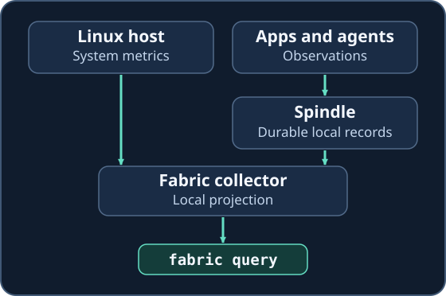
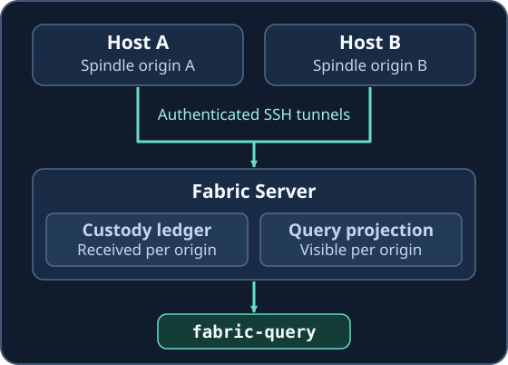

# FabricO11y

FabricO11y is a Linux observability toolkit you use from the command line.
See where CPU, memory, or disk pressure comes from, and investigate host and
application activity alongside telemetry from jobs and agents. Start on one
machine, or forward observations from several machines to a shared receiver.

## Quick start

1. **Install FabricO11y.** On x86-64 Fedora Workstation 44 or 45, get the
   signed RPM from [Releases](https://github.com/kmosoti/FabricO11y/releases)
   and follow the [Fedora setup guide](packaging/rpm/README.md#configure-a-fresh-rootless-instance).
   For a Linux Nix profile or the stable NixOS 26.05 module, use the
   [Nix installation guide](docs/nix-installation.md).
2. **Set up local collection.** Follow the
   [single-host instructions](docs/collection.md#choose-a-deployment) to
   configure Spindle and the collector as user services.
3. **Check the services and read your first metrics.** Once the services are
   running, use the CLI from the same user account.

   ```sh
   fabric production-ready --json
   fabric query metrics --since 1h --json
   ```

   The first command checks whether the collector and Spindle respond. The
   second reads the metrics collected so far within the last hour.

## Choose a deployment

### Single host

The collector samples the Linux host. Apps and agents send observations to
Spindle, which stores them locally. The collector reads those observations
through a Unix socket and makes them available to `fabric query`.



### Multiple hosts

Each host can keep collecting locally and forward from its own Spindle origin
to Fabric Server. Use authenticated SSH tunnels between hosts. Fabric Server
tracks received records and query visibility separately for each origin.
[Set up a fleet](docs/canonical-custody.md#connect-multiple-hosts).



## Operate and extend

- **Inspect an observation.** Use [`fabric projection-ready`](docs/collection.md#check-receipt-projection)
  to check whether a specific receipt is visible in the local or canonical projection.
- **Configure resource use.** Read [TOML settings](docs/settings.md) and
  [collector memory limits](docs/collection.md#elastic-collector-memory).
  Run `fabric settings` to see the resolved settings on your host.
- **Automate investigations.** Find typed queries and output formats in the
  [investigation guide](docs/investigation.md) and [CLI guide](docs/guide.md).
- **Integrate from Rust.** Depend on the zero-UI [`fabric-client`](fabric-client/Cargo.toml)
  workspace crate (`FabricClient` for `fabric.cli.v1` JSON subcommands and
  `FabricQueryClient` for `FABRIC_CREDENTIAL_FILE`-only `fabric-query` calls).
- **Work on FabricO11y.** See the [architecture](docs/architecture.md) and
  [contribution guide](CONTRIBUTING.md) for crate boundaries, build tools, and verification.
