# FabricO11y Architecture

`FabricO11y` is a **headless-by-default, CLI-first Linux host, autonomous-agent, and OTLP observability sensory plane** built in pure Rust (Edition 2024, Rust 1.100.0). It combines strictly bounded live Linux telemetry collection (`cgroups` v2, `/proc` PSI/swap/zram0, systemd unit hygiene, `inotify`/fd filesystem churn, optional GPU sysfs, and local Spindle/OTLP ingest) with an embedded pure-Rust converged storage and causal attribution engine rooted under `/data/fabrico11y`.

## 1. Crate & Authority Boundaries

Pure domain logic, schema contracts, statistical sketches, causal graph traversal, and formal admission arithmetic live in **Sans-I/O** crates (`admission-kernel`, `fabric-core`, `fabric-graph`, `fabric-corpus`, `fabric-colloquium`, `fabric-ops`, `fabric-evidence`, `fabric-query-contract`). All Linux kernel probing, embedded disk/memory custody, DataFusion query execution, and CLI rendering are isolated in dedicated I/O crates (`fabric-store`, `fabric-collect`, `fabric-query`, `fabric-cli`, plus preserved custody/protocol crates `fabric`, `fabric-server`, and `fabric-mcp`). Downstream Rust integrators consume `fabric.cli.v1` JSON outputs and `fabric-query` over bounded subprocess pipes via the lightweight, headless [`fabric-client`](../fabric-client/Cargo.toml) crate without pulling in Arrow, DataFusion, or UI crates. Dependency boundaries are machine-verified by [`verification/architecture.toml`](../verification/architecture.toml) via `cargo xtask architecture`.

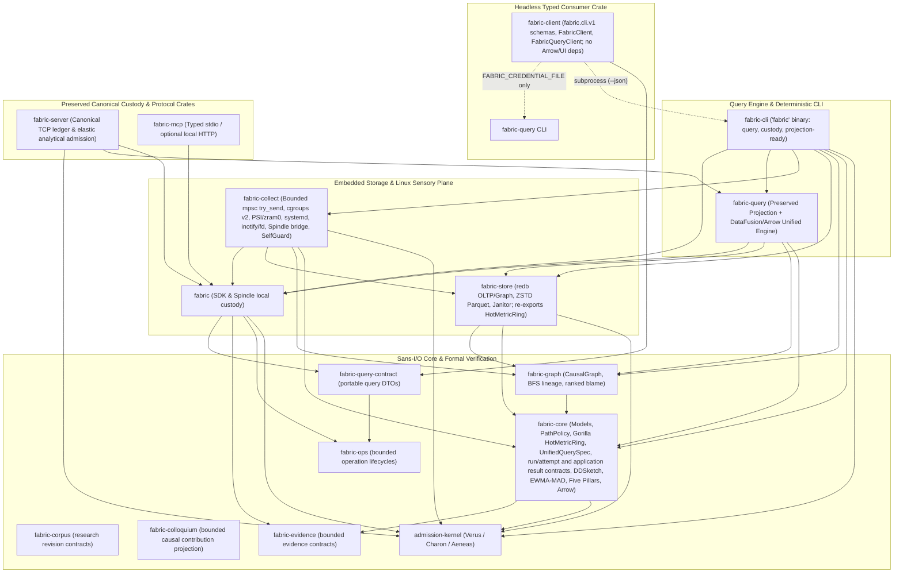

The portable `fabric-query-contract` package owns query DTOs, decimal wire
codecs, validation and operation bindings. `fabric::query` re-exports those
same types and keeps its native credential and transport client. Consumers
of `fabric-client` can use `query_contract` with default features disabled;
that path does not activate the native transport. Optional `query-schema`
forwards to the contract package. Query responses still carry generic JSON
rows, which consumers decode as the documented row type for the operation.

The optional `local-http` feature adds a single-request HTTP/1 transport on a
private Unix socket to the same typed handlers. Its credential and Reader or
Writer role are chosen at process launch. The connection and work permits bound
request handling and response delivery; canonical query cancellation retains its
work charge until the blocking exchange exits. Unix peer credentials establish a
local UID boundary subject to the operating system's namespace, same-UID and
file-descriptor-passing semantics. No TCP listener or browser-origin grant is
created.

### MCP request scheduling

The stdio adapter uses the same credential-bound canonical exchanges as the CLI.
Each Reader process admits one work exchange at a time, including analytical,
evidence, live metrics and segment inspection requests. A separate Writer
process admits one acceptance exchange at a time. The adapter reserves a
separate exchange for cancellation and keeps the analytical slot occupied until
the blocking exchange ends. Status calls queue in the order they start waiting
for the single status worker, with a 16-request total limit and a shared
five-second queue and transport budget per request. See the [investigation guide](investigation.md) for tool
assignments and overload behavior.

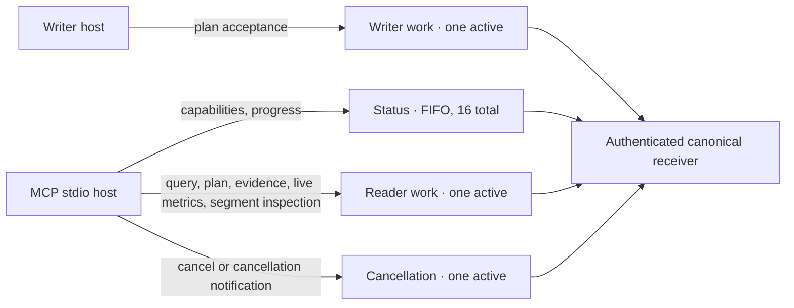

The independent [`fabric-corpus` contract](corpus-contract.md) defines research revision identities and attributed claims without a collector, transport, or storage dependency. Its bounded as-of view freezes explicit revision and relation membership and attributed conjunctive support groups. It retains missing selections, dissent and other relation claims; a group resolves only when its conclusion, every premise and each exact support edge are present. Resolution is not an entailment or custody claim. A bounded, pure lexical rebuild derives directed adjacent-token counts and revision provenance from selected text; missing selections remain explicit. A frozen citation context rechecks supplied passage bytes against selected revision source claims while preserving the view and its dissent. Bounded reconciliation analyzes explicitly selected same-object heads and rejects incomplete ancestry or an inexact merge. A portable-view differential compares explicitly selected dependencies and reports unresolved selection without claiming chronology or authority. Prior-failure claims cite a separate frozen basis and only report a matching selected observation as evidence-referenced.

Canonical plan acceptance uses a separately provisioned decision-writer grant.
The local SQLite transaction checks its persisted scope owner, recovers an
identical committed command before checking the head, and commits the decision,
head and exact result together. Proposal identity is checked against the local
committed canonical record, independently of later analytical projection.
Stored decisions do not authorize external execution.

A scope owner may read bounded pages of its canonical decisions. The first
request freezes the committed per-scope frontier; continuation tokens bind that
frontier and its row count, position, authority, owner, scope, expiry, and a
persisted revocation epoch. Each request rechecks the provisioned owner. Pages
contain at most 64 decisions, and token lifetimes are at most 900 seconds.
Tokens are signed, not encrypted; clients treat them as opaque and must not put
secrets in them. Expiration uses the receiver wall clock and can be affected by
clock adjustments. The owner can revoke outstanding cursors and hints by
incrementing the durable scope epoch. Expiry, revocation, invalid tokens and
loss of a row in an issued snapshot have distinct outcomes. There is no history
reclaimer or claim that a fresh snapshot detects earlier loss. The separate
query cursor key and profile are unchanged.

Subscriptions are advisory, in-memory, and limited to 32 per receiver for at
most 900 seconds. Creation returns the current frontier, and commits coalesce
into one pending bit per subscription. Polling does not wait. After a restart
or dropped hint, the owner resubscribes and replays canonical pages; hints are
never evidence of custody or a substitute for reading decisions.

The independent `fabric-colloquium` crate projects bounded contribution and
proposal state without I/O or runtime dependencies. Its distinct actor,
principal and team IDs are attribution claims, not authenticated authority.
Causal parents must be admitted first. A proposal supersedes directly cited
proposal heads; concurrent siblings remain discoverable, and custom kinds have
no implicit protocol behavior. The projection rejects excess records, parents
or heads without mutation. It does not provide durable admission, acceptance,
authorization or execution authority. Callers bound decoding and staging before
constructing contributions.

### Runtime-neutral operation lifecycles

`fabric-ops` defines five typed call shapes without a transport or runtime
dependency. Adapters supply peer identity and locality assertions and a local
monotonic millisecond clock; local and wire durations default to 10 seconds
and cannot exceed 30 seconds. A wire remaining-time budget is capped separately
from the local deadline. Each transition either returns a fixed-capacity effect
batch and commits its state, or returns an error with state unchanged. Message
counts and effects are bounded; adapters enforce payload byte limits. This
kernel does not authenticate peers or deliver effects. A bounded static registry
validates independent protocol and operation versions before returning a typed
handler token. Registry metadata conveys no authority; adapters retain request
and response types and choose their own transport and compatibility policy.
The `fabric::query` adapter binds its seven v1 operations to its existing query
DTOs, without changing their wire representation. An additive authenticated
canonical query command carries an operation version separately from the
existing request body; reader authorization and version checking precede
query preparation and resource reservation. Legacy query remains supported. The architecture check also
checks explicit native x86-64 and wasm32 normal/build dependency allowlists for
`fabric-ops`, `fabric-colloquium`, and `fabric-corpus`.
Batch construction is atomic with the in-memory transition; an adapter owns
any external delivery or durable transaction semantics. The public
`VerifiedPeer` constructor checks shape only: the value is an adapter
assertion, not evidence of authentication or authorization by itself.

Spindle's deployed Unix listener retains private evidence from `SO_PEERCRED`
only after the accepted socket's UID matches the server's UID; both remote-read
preparation and local request handling require that evidence. This is a local
OS UID in the server's user-namespace view, not a named application principal
or an effective authority. Same-UID processes share this boundary. Socket FD
handoff or a local proxy can allow a different process to send on the connected
socket, so the captured credentials do not identify every later sender. This
fact is not forwarded as authenticated application identity, and Spindle's
separate outbound canonical credential does not authenticate the local caller.
Policy-at-commit and broader authorization remain separate work.

The canonical TCP server maps a verified credential proof to the configured
reader, node-origin or decision-writer scope, then checks the request MAC before minting a
private grant for dispatch. The grant carries that scope and the server's
canonical authority; request fields cannot supply either. The grant establishes
credential possession under the configured scope, not a human or application
principal or the locality of a caller behind a proxy. It is not a substitute
for commit-time policy and authority revalidation.

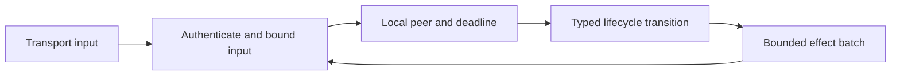

Canonical application readback uses an independently provisioned reader grant.
An additive exact-receipt request binds the expected authority, origin, source
ID, and observation identity in one authenticated response. The batch owner
reconstructs its immutable application digest before exposing a result or
recording its first local verified-read observation; parent selection comes
from the verified child and is confined to the same outbox. Reader origin grants
are not per-parent authorization, and this observation is distinct from
analytical projection visibility.

### Bounded multi-objective frontier

`fabric-evidence::frontier` projects up to 128 attempt rows against an explicit
profile of at most 16 ordered objectives. Each profile names the dataset, cohort,
and frozen cutoff by immutable reference; all axes share evaluator and
configuration and each axis names its objective, direction, unit and aggregation.
Only feasible, complete rows with the same profile participate. Invalid,
incomplete and incomparable rows and their evidence references are retained.
Strict Pareto dominance compares reported integer values directly; equal vectors
remain on the frontier and the minimum row ID identifies a dominator. Inexact
values remain attributed measurements, and the projection does not authenticate
references or establish feasibility, correctness, or authority. Inputs are
preflight bounded and malformed widths and duplicate row IDs are rejected.

### Frozen experiment snapshots

`fabric-evidence::snapshot` keeps a bounded case roster, named cutoff and
validated evaluator/configuration digest claims with one known or explicitly
unknown outcome per case. Supplementary snapshots identify their parent and a
distinct boundary. Comparisons require the same roster, unit, aggregation and
references, preserve missingness and exactness, and report observed numeric
differences only. This in-memory contract does not establish custody, cutoff
time ordering, corpus membership or statistical significance. Adapters must
bound input and reject duplicate keys before constructing sets and maps. A
separate `fabric.snapshot.v1` application payload carries at most 16 ordered
case references and must also fit the application-result 4 KiB and shape
limits. Parent and case digests are claims until authenticated readback; the
pure codec checks same-source cutoff ordinals without comparing clocks. The
batch adapter can authenticate the root, its known case references and one
optional parent boundary against its owner outbox and canonical reader before
returning a summary. It shares one deadline across the reads, rejects deeper
parent chains and retains unknown cases.

A policy-protected batch outbox loads trusted owner configuration before any
replay and binds its policy digest and expected origin in a distinct schema
version. A changed policy holds pending frames; an ordinary open cannot replay
that store. Protected application envelopes carry only permitted captured
bytes, their digest and policy provenance. This boundary applies to that batch
ingress; direct Spindle, ordinary batch and other collectors are separate.

### Application result envelope

`fabric-evidence` defines a bounded application-result envelope (also re-exported
through `fabric-core`) without changing
v2 or v3 custody. It carries a report UUID scoped by producer and origin,
an optional same-scope parent UUID, a versioned schema, producer completion
clock provenance, and distinct SHA-256 claims for original artifact bytes and
canonical application payload bytes. Scope is a label until an adapter qualifies
it; parent lookup and authorization are separate responsibilities. Source-byte
verification also canonicalizes the artifact and checks it against the payload.

The current `fabric.application-json.v1` profile accepts a JSON object up to
4 KiB, with at most 1,024 values, 64 members per container, 256-byte keys and
depth 8. It rejects duplicate decoded keys, floating point, exponent notation,
negative zero, and integers outside i64/u64. It sorts UTF-8 keys and emits
compact UTF-8 JSON without Unicode normalization; it is not JCS. The envelope
is limited to 16 KiB. A future adapter may use a nested object in v3 `JsonLog`,
but must enforce the actual frame and admission limits before staging. The
current `BatchClient` supports terminal agent/tool records only. No envelope
or application digest is a custody receipt or digest of the enclosing frame.

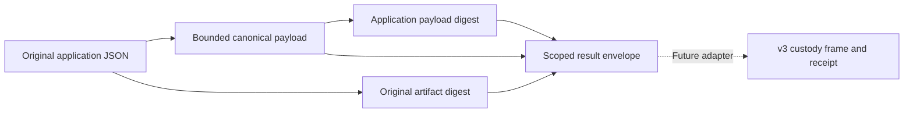

### Headless Consumer Client (`fabric-client`)

`fabric-client` isolates downstream Rust callers from Arrow, DataFusion, UI rendering crates, and direct storage locks:

- **Optional runtime feature (`default = ["cli"]`):** Callers can disable default features (`default-features = false`) for pure `serde` schema deserialization (`fabric.cli.v1`), or use `FabricClient` and `FabricQueryClient` asynchronously under `tokio`.
- **Credential-file-only reader auth (`FabricQueryClient`):** Rejects missing, empty, oversized (`> 4096 B`), or symlinked credential files before spawning `fabric-query`, injects `FABRIC_CREDENTIAL_FILE` and `FABRIC_ENDPOINT`, explicitly clears `FABRIC_CREDENTIAL` via `env_remove`, enables `kill_on_drop(true)` on every subprocess, and redacts any credential bytes from error output.

### Optional frontend boundary

The proposed frontend crates consume typed, authorized query results. The shared
app core owns models, navigation state, reducers, and transformations. Its
native and wasm builds must run identical reducer fixtures. Thin web and desktop
roots adapt transport and platform integration. Renderer dependencies stay in
the opt-in frontend graph.

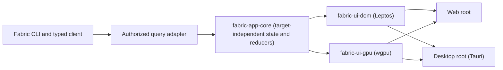

The backend currently ships headless packages. `cargo xtask architecture`
checks the declared direct dependencies and the default headless runtime and
build graphs. See the [frontend decision](../knowledge/decisions/D-0192-optional-frontend.md)
for the proposed crate boundaries and qualification requirements.

## 2. Converged Telemetry Engine & Self-Preservation Pipeline

All collection and query execution obeys hard self-preservation limits:

- **Zero `/tmp` or `/dev/shm` usage:** Enforced statically in `fabric-core::paths::validate_non_tmp_path`, CI scripts, and `fabric doctor --json`.
- **Single local storage tree (`/data/fabrico11y`):**
  - `state/catalog.redb` + `state/live_state.json`: live entity registry, adjacency tables (`adj_out`/`adj_in`), unit hygiene records, watermarks (including `spindle_watermark_id`, persisted strictly **after** all OLAP Parquet domain flushes succeed), and recent anomalies.
  - `HotMetricRing` (in RAM, Sans-I/O in `fabric-core`): strictly capped at `32 MiB` with modular `wrapping` Gorilla delta-of-delta + XOR compression (preserving `labels_json`), buffer rollback on failed flush, and 60s Parquet flushes.
  - `olap/{metrics,logs,traces,fs_events,edges}/dt=YYYY-MM-DD/*.parquet`: ZSTD-compressed Arrow/Parquet partitions bounded by `RetentionJanitor` (`4 GiB` default cap, >7d downsampling).
- **Resource confinement (`fabrico11y.slice`):** `MemoryHigh=256M`, `MemoryMax=512M`, `CPUQuota=15%`, `IOWeight=30`, `TasksMax=64`, plus a `200 MiB` RSS self-shedding watchdog inside `fabric-collect`. The collector derives an [elastic hot cache budget](collection.md#elastic-collector-memory) from cgroup v2 and returns optional cache capacity on pressure. The staging and custody paths retain their existing charge and recovery contracts.
- **Receiver resource leases:** Spindle and Fabric Server derive connection capacity from the process descriptor limit. Fabric Server samples memory and descriptor pressure to defer fresh analytical work. Active leases keep their charge through cleanup, and canonical custody and readback use the normal connection and storage paths. See [receiver resource pressure](canonical-custody.md#resource-pressure).
- **Formal proofs & fuzzing (`proofs/`, `fuzz/`):** Verus + Charon/Aeneas Lean 4 (`ExtractedAdmission.lean`), standalone Lean 4 (`Telemetry.lean`), Z3 `QF_BV` SMT (`TelemetrySmt.smt2`), and 8 `cargo-fuzz` targets (`gorilla_ring_roundtrip`, `unified_query_and_ipc`, `causal_graph_and_wire`, plus 5 core custody targets).

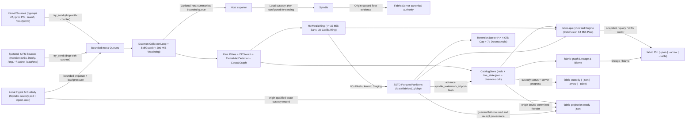

When the local live metric cursor is enabled and the configured collector tick
exceeds one second, a separate skipped-tick Spindle poll shares the same
serialized projection path. Backpressure defers these polls until a normal tick
services the existing flush and retention paths. This does not change the host
collection cadence or turn the cursor into a custody frontier.

The local projection binds its Spindle origin before staging a contiguous prefix.
New metrics, logs, and traces carry internal receipt provenance in Parquet. The
public query schema omits this field. Compaction retains raw provenance and metric
rollups discard it. The readiness check reads the catalog and the queryable raw
row within one deadline. Results describe that observation at the time of the
read. Retention can subsequently remove the evidence.

The opt-in host exporter reuses the local snapshot. A full export queue can drop
new batches without blocking collection. Local projection advances over exported
copies for the configured node because its existing observations already cover
those host signals.

A canonical receipt check authenticates a reader and binds the expected authority and
origin. The receiver reports custody and analytical frontiers separately.

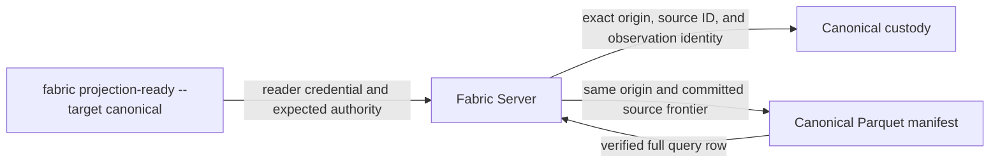

The canonical probe reuses the bounded analytical worker. It confirms the full
projected row from the committed Parquet segment within the request budget. Native
engine mode reports unavailable when it has no independent Parquet witness.

`receipt-batch-ready` takes one authorized origin, authority, explicit source
barrier and at most 256 receipt identities. The receiver captures custody once
and holds the projection mutex over one manifest read and its bounded segment
inspection; these are independently observed frontiers, not a cross-request
snapshot or a promise of historical retention. It checks custody identity and
the complete projected row for each requested item. One request spends at most
4 MiB of canonical row bytes and reserves at most 64 MiB and 32,768 rows of
projection segments; guarded Parquet limits also apply. Segment evidence is
verified once per touched segment. Deadline, count and byte exhaustion leave
individual outcomes unavailable. Deadline checks occur around I/O and between guarded decoder validation stages;
individual footer, page and Arrow operations are not preemptible mid-call. Rows beyond the
caller's barrier are not looked up. The lock is held for this inspection; this can delay
projection work for other origins. Native engine mode remains unavailable.

## Versioned service configuration

The shared loader reads bounded regular files. Explicit service launch paths
support versioned TOML and the existing JSON format. Collector profiles resolve
configuration per field, and the read-only inspector reports the selected
values and where they came from. [Settings](settings.md)

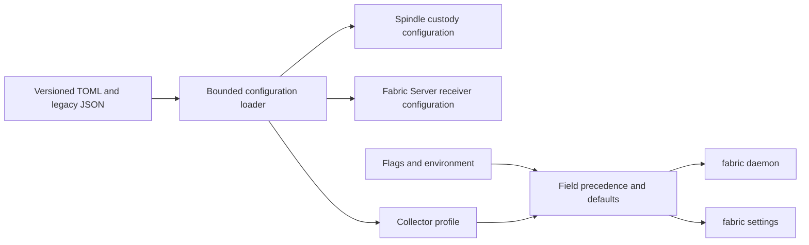

### Lineage and process attribution

Lineage in both directions is the union of separate upstream and downstream
traversals from the matched roots, each bounded by the requested depth. Agent
attribution checks known browser identities first, then the executable or process
name, a direct script invoked by a supported interpreter, and finally the unit
name. Arbitrary arguments do not establish agent identity. Unrecognized
processes in `agent.slice` retain the process-name fallback.

## 3. Integration and release

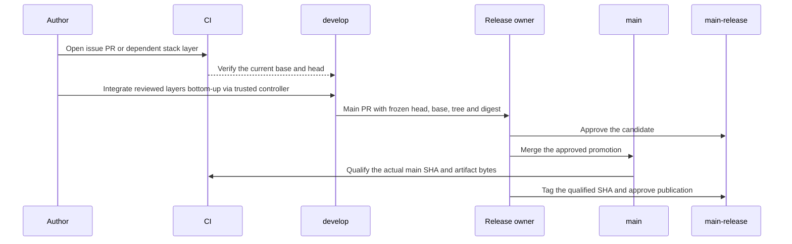

The trusted develop integration controller validates authenticated live PR,
merge-preview, hosted checkout and independent review facts using the read-only
`cargo xtask integration verify` predicate from trusted develop. It serializes
landing and refreshes evidence on changes; the predicate does not authenticate
facts or mutate GitHub. The [contributor procedure](../CONTRIBUTING.md#current-base-integration-evidence)
defines the trust boundary and protected-path baseline. GitHub enforces the two
named development checks; independent review is enforced by this procedure.

The [promotion runbook](release-promotion.md) covers ref checks, the existing
branch divergence, and the release evidence required before tagging.

The development workflow runs the common workspace validation and release
restart smoke in `verify`. The parallel `native-acceptance` job exercises
exact coverage selectors, native proof and falsification checks, engine
recovery, and fuzzing. Scheduled and manual runs add the workflow-specific
tests without repeating the common group. Local candidate verification runs
the full acceptance tier.

Product CI builds use the Rust version in `rust-toolchain.toml`. Native verifiers
use independent compiler pins. The bootstrap reuses the managed OPAM switch when
the installed packages match the full lock. It reuses the Aeneas executable when
the lock and executable digests match its recorded build.

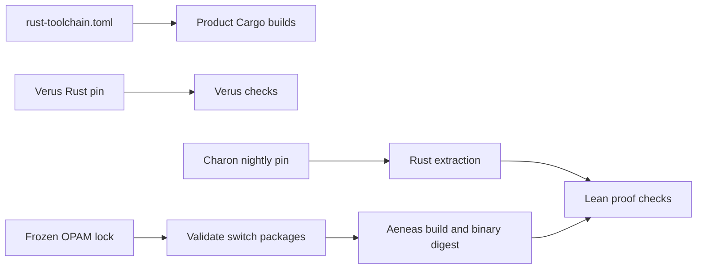

### CI tool images

The tool-image workflow builds two Linux x86-64 Fedora images when trusted
`develop` changes affect provisioning. The common image contains Rust,
Jujutsu, and Weaver. The native image shares the common layers and also
contains the proof and fuzz toolchains and the native engine test binary.
Installed tools live under `/opt/fabrico11y`, outside the Actions home mount.
A trusted manual dispatch can also build a separate seeded common candidate.
Its registry compiler entries are available only to compatible release builds.
Every job builds the current workspace in its own Cargo target directory.

```mermaid
flowchart LR
    Pins["Trusted develop revision and tool pins"] --> Common["Build common image"]
    Common --> Native["Build native image"]
    Common --> Seed["Build optional common compiler seed"]
    Common --> Offline["Verify installed tools without network"]
    Native --> Offline
    Seed --> Offline
    Offline --> Registry["Publish images and record digests"]
    Harness["Qualification workflow changes"] --> Sim["Run deterministic plan and report fixtures"]
    Registry --> Plan["Validate source and public digest on explicit live dispatch"]
    Plan --> Cold["Compare both lanes on each hosted VM"]
    Cold --> Warm["Repeat with exact cache hits on fresh hosted runners"]
    Warm --> Review["Review adoption in development checks"]
    Review --> Verify["verify uses the pinned seeded common image"]
    Review --> Acceptance["native-acceptance uses the pinned native image"]
```

Routine qualification checks simulate plan and report behavior with offline
fixtures. An explicit live comparison runs both variants on the same hosted
VM for each cold or warm pair. Each lane uses a fresh container store. Warm lanes restore
only their exact trial cache. The development jobs use the qualified image
digests and check the installed tools against the source pins before restoring
caches. The seeded release launcher falls back to Cargo when the checkout's
seed policy differs. Dependency sources can be reused across revisions.
Compiled Cargo and fuzz archives require the exact tested commit and
compatible build inputs.
Only successful `develop` pushes publish these caches. See
[CI image qualification](ci-images.md) for the comparison and adoption procedure.

## 4. Single-Host and Distributed Deployment

`cargo xtask collection install-stack` provisions a co-located rootless user service stack confined inside `fabrico11y.slice` (`MemoryHigh=256M`, `MemoryMax=512M`, `CPUQuota=15%`, `IOWeight=30`, `TasksMax=64`) with explicit `TMPDIR=/data/tmp` and `KillMode=control-group`. Its units omit rootless namespace mounts (`PrivateTmp` and `ProtectSystem=strict`) that fail under SELinux user managers.

The local Spindle and collector path can run without a receiver. A fleet runs the same local path on each host and forwards multiple persistent origins to one canonical authority. Both ends of a remote handoff use loopback listeners and the tunnel supplies the authenticated cross-host transport. The receiver's original-byte ledger and rebuildable analytical projection report separate per-origin progress. See [local collection](collection.md#choose-a-deployment) and [multi-host setup](canonical-custody.md#connect-multiple-hosts).

The opt-in [batch adapter](collection.md#sequential-terminal-reports) persists
one terminal report before submission. It reuses a Spindle generation across
different run identities. If a receipt is lost, the same wire identity and
bytes are submitted again while the generation remains valid. Confirmed
receipts are retained within the outbox limit.

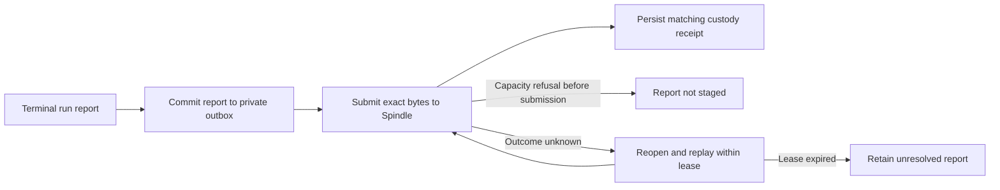

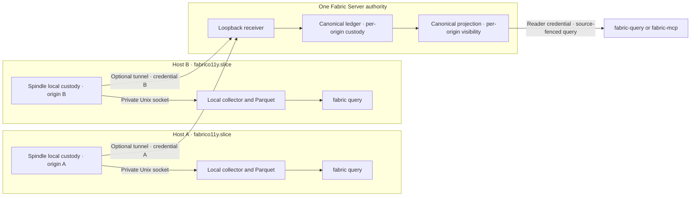

## Service self-telemetry custody

Service exporters submit observations through the local SDK into a dedicated
Spindle socket and custody directory. Each service instance owns a bounded SDK
queue. The telemetry Spindle owns a separate persistent origin and can forward
through the existing canonical protocol. Use separate local projection storage
when inspecting this origin alongside the workload Spindle origin.

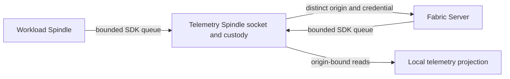

The telemetry Spindle runs with self-telemetry export disabled. Services suppress
per-record telemetry for activity on this lane and report queue and delivery
diagnostics locally.

## Bounded run and attempt evidence manifests

`fabric-evidence::evidence_manifest` (also available through the existing
`fabric-core::evidence_manifest` path) defines a versioned Sans-I/O JSON contract for
immutable run context, attempt-specific overrides, and observation references.
An envelope contains one shared run manifest, bounded attempt manifests that
reference it by ID and digest, and observations that reference an attempt by ID
and digest. Observations carry record digests and time provenance rather than
copying run context. Digest roles are distinct Rust types for run manifests,
attempt manifests, shared artifact content, each observation's original
artifact bytes, exact canonical record bytes, and physical files.

Run and attempt digests use `fabric.manifest.canonical-json.v1`: SHA-256 over
compact UTF-8 JSON for the closed typed payload, excluding its own `digest`
member. Run payload keys are ordered `schema_version`, `immutable_id`, `code`,
`source_tree`, `configuration`, `inputs`, `dataset`, `cohort`, `evaluator`,
`toolchain`, `capture_policy`, `artifacts`. Attempt payload keys are ordered
`schema_version`, `immutable_id`, `run`, `overrides`. Nested artifact keys are
`kind`, `locator`, `media_type`, `digest`; digest keys are `algorithm`,
`representation`, `hex`; references use `id`, `digest`; overrides use `kind`,
`artifact`. Available disclosure values are `{"state":"available","value":...}`;
other states contain only `state`.

The profile uses integer-only numeric values. It emits non-ASCII scalar values
as UTF-8, escapes quotes and backslashes, uses JSON escapes for control
characters (`\b`, `\t`, `\n`, `\f`, `\r`, then lowercase `\u00xx` for other
U+0000..U+001F controls), does not escape `/`, and emits no spaces or trailing
newline. It has no generic maps,
duplicate-key parsing, floating-point values, or arbitrary input JSON
normalization. The decoder rejects duplicate struct members. `canonical_bytes`
and validation recompute manifest hashes before accepting the declaration.
Changing field order, escaping, enum spelling, or payload fields requires a new
profile version and known-answer vector.

Artifact content, original artifact, canonical record, and physical-file claims
use SHA-256 over their respective exact bytes (`exact_bytes`), including source
or storage trailing newlines. Typed `verify_exact_bytes` methods compare these
claims against supplied bytes. An application file and its submitted record can
therefore have different digests while retaining explicit roles.

The manifest canonical profile is not the canonical result encoding for #196.
Application-defined results need a separate closed, versioned result schema and
its own canonical byte profile. Until that exists, canonical-record digests
identify the exact accepted payload bytes, and original artifact files retain
their own exact-byte digests.

The decoder rejects wire bodies above 64 KiB before JSON parsing. The JSON
encoder uses a 64 KiB capped writer so escaping cannot grow an unbounded
intermediate; this matches the existing 64 KiB observation frame budget.
Envelopes contain at most 64 attempts and 64 observations; a run has at most 32
artifacts. An attempt allows up to 32 unique input overrides and one each of
the evaluator, toolchain, and capture-policy overrides. If any input override
is present, those entries replace the entire run input set in their declared
order; they are not appended or matched to run entries by locator. With no
input override, the attempt inherits the run's complete explicit input
disclosure. An empty
attempt-level replacement cannot be encoded, so attempt-level clearing is not
supported; an empty `available` input list remains an explicit run-level empty
set. IDs are at most 128 bytes; artifact locators 1,024 bytes; media types 128
bytes; clock IDs 128 bytes; clock sources 256 bytes. Fields use explicit
`available`, `unavailable`, `redacted`, `unknown`, and `inapplicable` states.
Each supplied source,
observed, custody, or verified time carries a clock ID and source; timestamps
from different clocks have no global order guarantee. This contract does not
activate collection, storage, telemetry migration, or custody verification.
