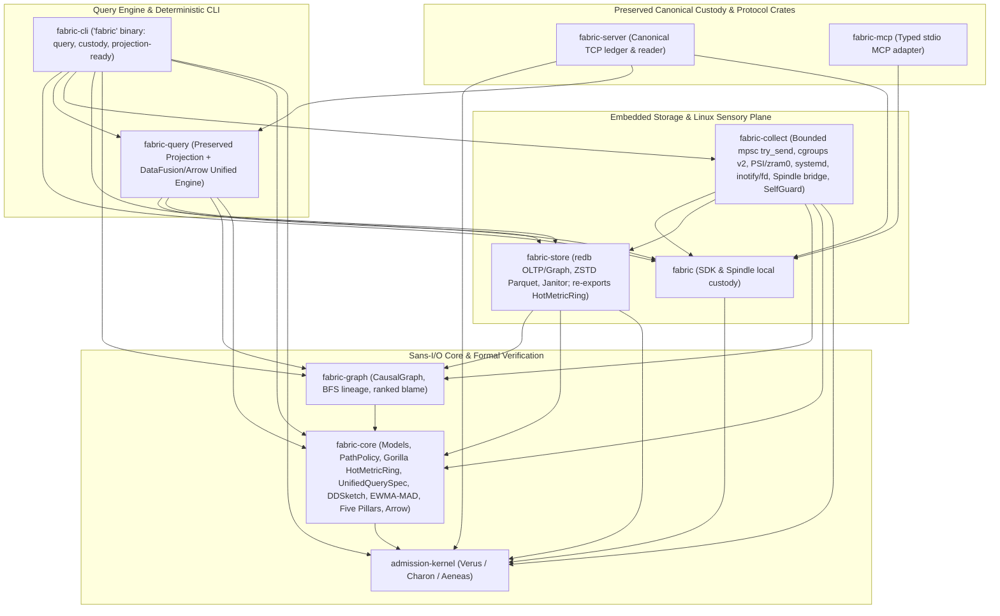
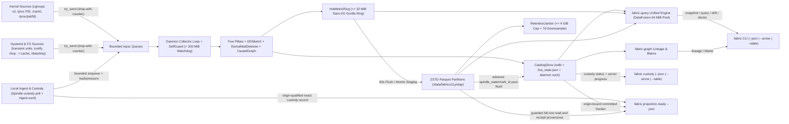
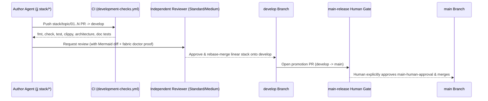
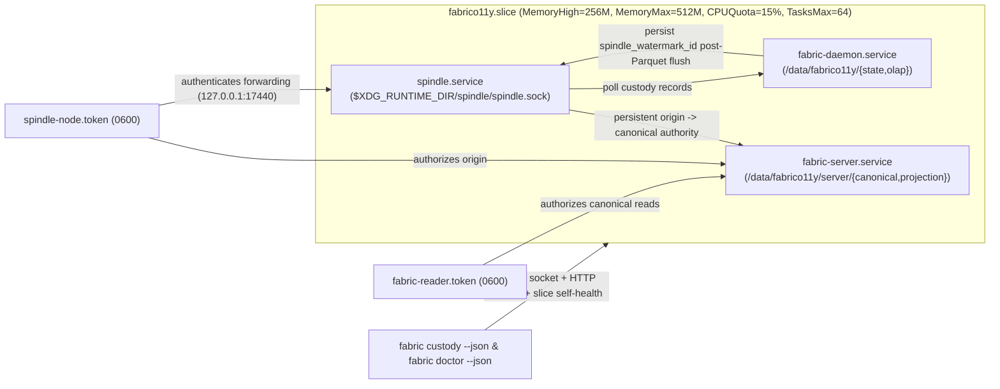
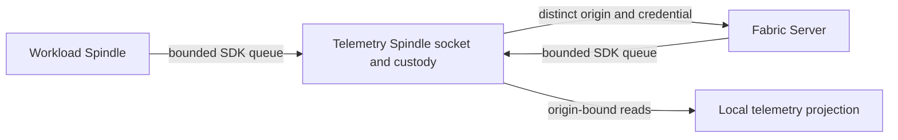

# FabricO11y Architecture

`FabricO11y` is a **CLI-first, zero-UI Linux host, autonomous-agent, and OTLP observability sensory plane** built in pure Rust (Edition 2024, Rust 1.100.0). It combines strictly bounded live Linux telemetry collection (`cgroups` v2, `/proc` PSI/swap/zram0, systemd unit hygiene, `inotify`/fd filesystem churn, optional GPU sysfs, and local Spindle/OTLP ingest) with an embedded pure-Rust converged storage and causal attribution engine rooted under `/data/fabrico11y`.

## 1. Crate & Authority Boundaries

Pure domain logic, schema contracts, statistical sketches, causal graph traversal, and formal admission arithmetic live in **Sans-I/O** crates (`admission-kernel`, `fabric-core`, `fabric-graph`). All Linux kernel probing, embedded disk/memory custody, DataFusion query execution, and CLI rendering are isolated in dedicated I/O crates (`fabric-store`, `fabric-collect`, `fabric-query`, `fabric-cli`, plus preserved custody/protocol crates `fabric`, `fabric-server`, and `fabric-mcp`). Dependency boundaries are machine-verified by [`verification/architecture.toml`](../verification/architecture.toml) via `cargo xtask architecture`.

## 2. Converged Telemetry Engine & Self-Preservation Pipeline

All collection and query execution obeys hard self-preservation limits:

- **Zero `/tmp` or `/dev/shm` usage:** Enforced statically in `fabric-core::paths::validate_non_tmp_path`, CI scripts, and `fabric doctor --json`.
- **Single local storage tree (`/data/fabrico11y`):**
  - `state/catalog.redb` + `state/live_state.json`: live entity registry, adjacency tables (`adj_out`/`adj_in`), unit hygiene records, watermarks (including `spindle_watermark_id`, persisted strictly **after** all OLAP Parquet domain flushes succeed), and recent anomalies.
  - `HotMetricRing` (in RAM, Sans-I/O in `fabric-core`): strictly capped at `32 MiB` with modular `wrapping` Gorilla delta-of-delta + XOR compression (preserving `labels_json`), buffer rollback on failed flush, and 60s Parquet flushes.
  - `olap/{metrics,logs,traces,fs_events,edges}/dt=YYYY-MM-DD/*.parquet`: ZSTD-compressed Arrow/Parquet partitions bounded by `RetentionJanitor` (`4 GiB` default cap, >7d downsampling).
- **Resource confinement (`fabrico11y.slice`):** `MemoryHigh=256M`, `MemoryMax=512M`, `CPUQuota=15%`, `IOWeight=30`, `TasksMax=64`, plus a `200 MiB` RSS self-shedding watchdog inside `fabric-collect`.
- **Formal proofs & fuzzing (`proofs/`, `fuzz/`):** Verus + Charon/Aeneas Lean 4 (`ExtractedAdmission.lean`), standalone Lean 4 (`Telemetry.lean`), Z3 `QF_BV` SMT (`TelemetrySmt.smt2`), and 8 `cargo-fuzz` targets (`gorilla_ring_roundtrip`, `unified_query_and_ipc`, `causal_graph_and_wire`, plus 5 core custody targets).

The local projection binds its Spindle origin before staging a contiguous prefix.
New metrics, logs, and traces carry internal receipt provenance in Parquet. The
public query schema omits this field. Compaction retains raw provenance and metric
rollups discard it. The readiness check reads the catalog and the queryable raw
row within one deadline. Results describe that observation at the time of the
read. Retention can subsequently remove the evidence.

## 3. Two-Branch Stacked Development Workflow & Release Gate

Following the repository workflow anchored in [`knowledge/decisions/D-0001-development-workflow.md`](../knowledge/decisions/D-0001-development-workflow.md):

1. Agent authors develop linear atomic stacks via colocated Jujutsu (`jj`) bookmarks (`stack/<topic>/01-...`).
2. Every PR targeting `develop` runs CI (`development-checks.yml`), requires an updated Mermaid diagram for structural changes, and undergoes independent review (preferring an alternate model family or fresh standard/medium reasoning context) before linear rebase integration onto `develop`.
3. Only explicit promotion PRs from `develop` to `main` may update `main`, gated by the human-approved `main-release` environment in [`.github/workflows/main-human-gate.yml`](../.github/workflows/main-human-gate.yml).

## 4. Production Systemd Stack & Coupled Custody Topology

On `fedora-blade`, `cargo xtask collection install-stack` provisions a coupled rootless user service stack confined inside `fabrico11y.slice` (`MemoryHigh=256M`, `MemoryMax=512M`, `CPUQuota=15%`, `IOWeight=30`, `TasksMax=64`) with explicit `TMPDIR=/data/tmp`, `KillMode=control-group`, and no rootless namespace mounts (`PrivateTmp` / `ProtectSystem=strict`) that fail under SELinux user managers.

## Service self-telemetry custody

Service exporters submit observations through the local SDK into a dedicated
Spindle socket and custody directory. Each service instance owns a bounded SDK
queue. The telemetry Spindle owns a separate persistent origin and can forward
through the existing canonical protocol. Use separate local projection storage
when inspecting this origin alongside the workload Spindle origin.

The telemetry Spindle runs with self-telemetry export disabled. Services suppress
per-record telemetry for activity on this lane and report queue and delivery
diagnostics locally.
