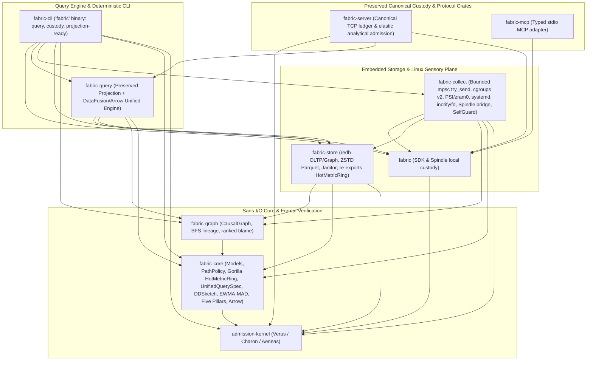
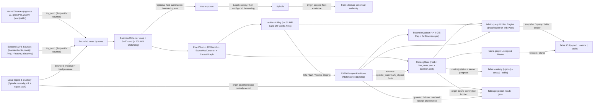
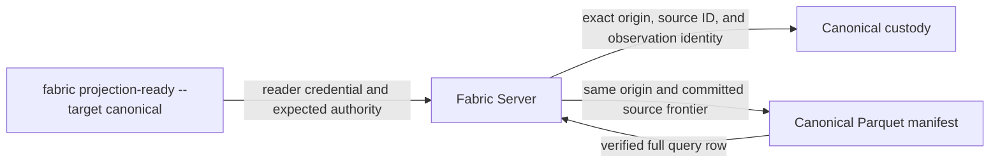
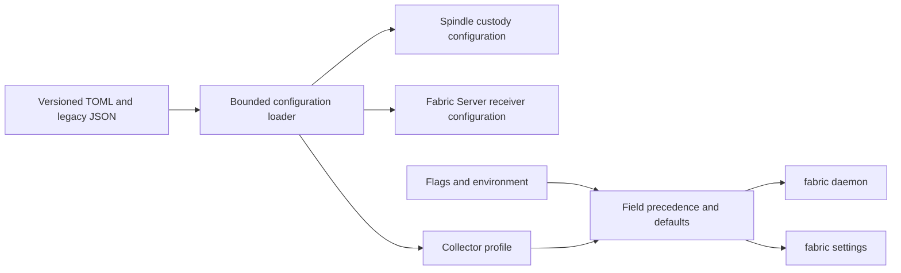
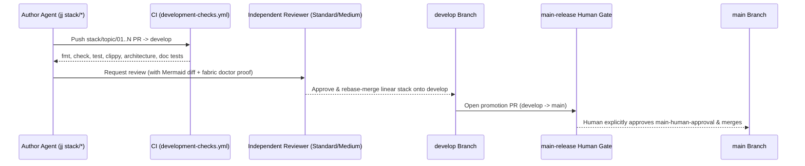
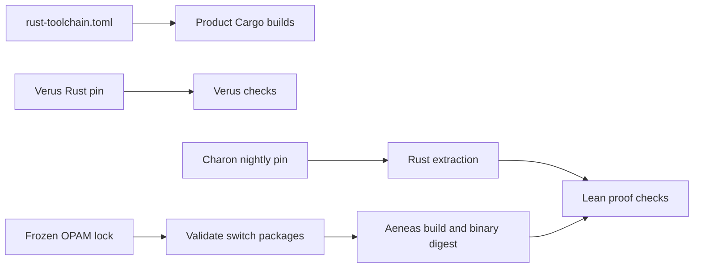
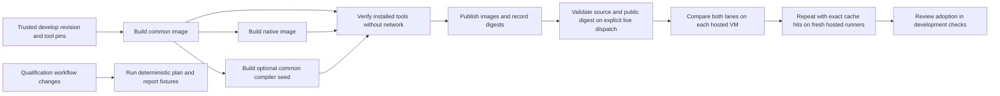
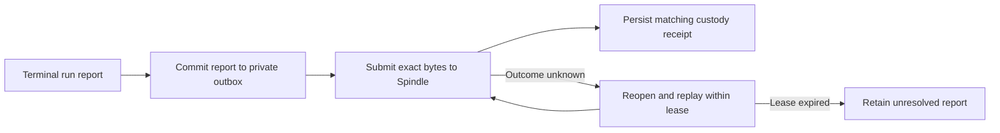
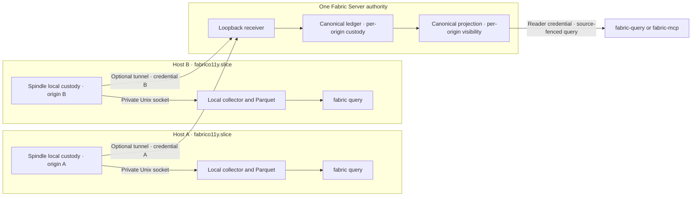
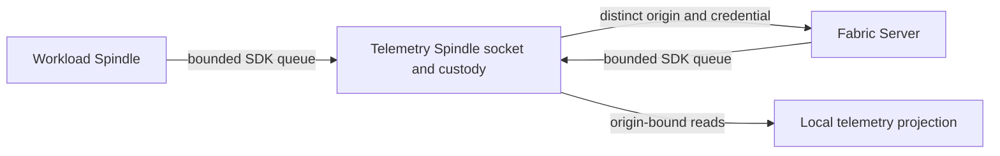

# FabricO11y Architecture

`FabricO11y` is a **CLI-first, zero-UI Linux host, autonomous-agent, and OTLP observability sensory plane** built in pure Rust (Edition 2024, Rust 1.100.0). It combines strictly bounded live Linux telemetry collection (`cgroups` v2, `/proc` PSI/swap/zram0, systemd unit hygiene, `inotify`/fd filesystem churn, optional GPU sysfs, and local Spindle/OTLP ingest) with an embedded pure-Rust converged storage and causal attribution engine rooted under `/data/fabrico11y`.

## 1. Crate & Authority Boundaries

Pure domain logic, schema contracts, statistical sketches, causal graph traversal, and formal admission arithmetic live in **Sans-I/O** crates (`admission-kernel`, `fabric-core`, `fabric-graph`). All Linux kernel probing, embedded disk/memory custody, DataFusion query execution, and CLI rendering are isolated in dedicated I/O crates (`fabric-store`, `fabric-collect`, `fabric-query`, `fabric-cli`, plus preserved custody/protocol crates `fabric`, `fabric-server`, and `fabric-mcp`). Dependency boundaries are machine-verified by [`verification/architecture.toml`](../verification/architecture.toml) via `cargo xtask architecture`.

## 2. Converged Telemetry Engine & Self-Preservation Pipeline

All collection and query execution obeys hard self-preservation limits:

- **Zero `/tmp` or `/dev/shm` usage:** Enforced statically in `fabric-core::paths::validate_non_tmp_path`, CI scripts, and `fabric doctor --json`.
- **Single local storage tree (`/data/fabrico11y`):**
  - `state/catalog.redb` + `state/live_state.json`: live entity registry, adjacency tables (`adj_out`/`adj_in`), unit hygiene records, watermarks (including `spindle_watermark_id`, persisted strictly **after** all OLAP Parquet domain flushes succeed), and recent anomalies.
  - `HotMetricRing` (in RAM, Sans-I/O in `fabric-core`): strictly capped at `32 MiB` with modular `wrapping` Gorilla delta-of-delta + XOR compression (preserving `labels_json`), buffer rollback on failed flush, and 60s Parquet flushes.
  - `olap/{metrics,logs,traces,fs_events,edges}/dt=YYYY-MM-DD/*.parquet`: ZSTD-compressed Arrow/Parquet partitions bounded by `RetentionJanitor` (`4 GiB` default cap, >7d downsampling).
- **Resource confinement (`fabrico11y.slice`):** `MemoryHigh=256M`, `MemoryMax=512M`, `CPUQuota=15%`, `IOWeight=30`, `TasksMax=64`, plus a `200 MiB` RSS self-shedding watchdog inside `fabric-collect`. The collector derives an [elastic hot cache budget](collection.md#elastic-collector-memory) from cgroup v2 and returns optional cache capacity on pressure. The staging and custody paths retain their existing charge and recovery contracts.
- **Receiver resource leases:** Spindle and Fabric Server derive connection capacity from the process descriptor limit. Fabric Server samples memory and descriptor pressure to defer fresh analytical work. Active leases keep their charge through cleanup, and canonical custody and readback use the normal connection and storage paths. See [receiver resource pressure](canonical-custody.md#resource-pressure).
- **Formal proofs & fuzzing (`proofs/`, `fuzz/`):** Verus + Charon/Aeneas Lean 4 (`ExtractedAdmission.lean`), standalone Lean 4 (`Telemetry.lean`), Z3 `QF_BV` SMT (`TelemetrySmt.smt2`), and 8 `cargo-fuzz` targets (`gorilla_ring_roundtrip`, `unified_query_and_ipc`, `causal_graph_and_wire`, plus 5 core custody targets).

The local projection binds its Spindle origin before staging a contiguous prefix.
New metrics, logs, and traces carry internal receipt provenance in Parquet. The
public query schema omits this field. Compaction retains raw provenance and metric
rollups discard it. The readiness check reads the catalog and the queryable raw
row within one deadline. Results describe that observation at the time of the
read. Retention can subsequently remove the evidence.

The opt-in host exporter reuses the local snapshot. A full export queue can drop
new batches without blocking collection. Local projection advances over exported
copies for the configured node because its existing observations already cover
those host signals.

A canonical receipt check authenticates a reader and binds the expected authority and
origin. The receiver reports custody and analytical frontiers separately.

The canonical probe reuses the bounded analytical worker. It confirms the full
projected row from the committed Parquet segment within the request budget. Native
engine mode reports unavailable when it has no independent Parquet witness.

## Versioned service configuration

The shared loader reads bounded regular files. Explicit service launch paths
support versioned TOML and the existing JSON format. Collector profiles resolve
configuration per field, and the read-only inspector reports the selected
values and where they came from. [Settings](settings.md)

## 3. Two-Branch Stacked Development Workflow & Release Gate

Following the repository workflow anchored in [`knowledge/decisions/D-0001-development-workflow.md`](../knowledge/decisions/D-0001-development-workflow.md):

1. Agent authors develop linear atomic stacks via colocated Jujutsu (`jj`) bookmarks (`stack/<topic>/01-...`).
2. Every PR targeting `develop` runs CI (`development-checks.yml`), requires an updated Mermaid diagram for structural changes, and undergoes independent review (preferring an alternate model family or fresh standard/medium reasoning context) before linear rebase integration onto `develop`.
3. Only explicit promotion PRs from `develop` to `main` may update `main`, gated by the human-approved `main-release` environment in [`.github/workflows/main-human-gate.yml`](../.github/workflows/main-human-gate.yml).

The development workflow runs the common workspace validation and release
restart smoke in `verify`. The parallel `native-acceptance` job exercises
exact coverage selectors, native proof and falsification checks, engine
recovery, and fuzzing. Scheduled and manual runs add the workflow-specific
tests without repeating the common group. Local candidate verification runs
the full acceptance tier.

Product CI builds use the Rust version in `rust-toolchain.toml`. Native verifiers
use independent compiler pins. The bootstrap reuses the managed OPAM switch when
the installed packages match the full lock. It reuses the Aeneas executable when
the lock and executable digests match its recorded build.

### CI tool images

The tool-image workflow builds two Linux x86-64 Fedora images when trusted
`develop` changes affect provisioning. The common image contains Rust,
Jujutsu, and Weaver. The native image shares the common layers and also
contains the proof and fuzz toolchains and the native engine test binary.
Installed tools live under `/opt/fabrico11y`, outside the Actions home mount.
A trusted manual dispatch can also build a separate seeded common candidate.
Its registry compiler entries are available only to compatible release builds.
Every job builds the current workspace in its own Cargo target directory.

Routine qualification checks simulate plan and report behavior with offline
fixtures. An explicit live comparison runs both variants on the same hosted
VM for each cold or warm pair. Each lane uses a fresh container store. Warm lanes restore
only their exact trial cache. The development jobs use the current Fedora image
until candidate digests pass hosted qualification. The workflow reuses
dependency downloads across source revisions. Its compiled Cargo and fuzz
archives require the exact tested commit and compatible build inputs.
Only successful `develop` pushes publish these caches. See
[CI image qualification](ci-images.md) for the comparison and adoption procedure.

## 4. Single-Host and Distributed Deployment

`cargo xtask collection install-stack` provisions a co-located rootless user service stack confined inside `fabrico11y.slice` (`MemoryHigh=256M`, `MemoryMax=512M`, `CPUQuota=15%`, `IOWeight=30`, `TasksMax=64`) with explicit `TMPDIR=/data/tmp` and `KillMode=control-group`. Its units omit rootless namespace mounts (`PrivateTmp` and `ProtectSystem=strict`) that fail under SELinux user managers.

The local Spindle and collector path can run without a receiver. A fleet runs the same local path on each host and forwards multiple persistent origins to one canonical authority. Both ends of a remote handoff use loopback listeners and the tunnel supplies the authenticated cross-host transport. The receiver's original-byte ledger and rebuildable analytical projection report separate per-origin progress. See [local collection](collection.md#choose-a-deployment) and [multi-host setup](canonical-custody.md#connect-multiple-hosts).

The opt-in [batch adapter](collection.md#sequential-terminal-reports) persists
one terminal report before submission. It reuses a Spindle generation across
different run identities. If a receipt is lost, the same wire identity and
bytes are submitted again while the generation remains valid. Confirmed
receipts are retained within the outbox limit.

## Service self-telemetry custody

Service exporters submit observations through the local SDK into a dedicated
Spindle socket and custody directory. Each service instance owns a bounded SDK
queue. The telemetry Spindle owns a separate persistent origin and can forward
through the existing canonical protocol. Use separate local projection storage
when inspecting this origin alongside the workload Spindle origin.

The telemetry Spindle runs with self-telemetry export disabled. Services suppress
per-record telemetry for activity on this lane and report queue and delivery
diagnostics locally.
