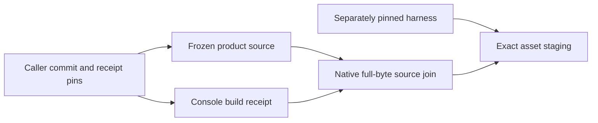
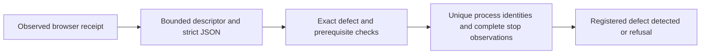

# Engineering evidence composition

The Rust `xtask evidence-preflight` command checks a caller-pinned inventory;
it neither executes jobs nor replaces acceptance graders. The
[contract](../experiments/formal/engineering-evidence-protocol.md) defines its
schema, bounded inputs, controls and finite experiment.

`File` ownership keeps no-follow directory descriptors alive across component
lookup. Streaming hashes and bounded JSON avoid retaining packages; one digest
per invocation serves repeated references. Device/inode/size/mtime/ctime checks
reject exercised replacement/write races, without authenticating hostile producers
or privileged concurrent writers.

Numeric adjacency/indegrees and a ready min-heap avoid rescanning dependencies.
Literal argv/source/exit/unit/stop joins refuse copied service identities and
unmet prerequisites. Bounds apply to the complete composition, not just output.
An incomplete inventory cannot reveal omitted required cases. The tooling-layer
crate uses existing locked dependencies; no product/core boundary changes.

The [architecture review skill](../../.agents/skills/architecture-review/SKILL.md)
routes unresolved design decisions to focused experiments and documentation work.
Existing Python product oracles stay independent; no MCP server is required.

## Pinned CI tool install

`cargo xtask install-tool <crate> <version>` is the effectful Rust boundary for
one explicitly pinned Cargo installation. It inherits `CARGO_HOME`, requires
2 GiB available DATA headroom, and assigns Cargo a private target under owned
scratch. A fixed 1500-second timeout kills the process group and reaps Cargo;
cleanup removes the target while retaining the log and JSON receipt under
`$FABRIC_STORAGE_ROOT/results/ci-tool-install/`. The Python resource-group
launcher remains mandatory outside this command. Registered controls have not
performed an actual install or completed full fast migration verification; see
the [installer protocol](../experiments/formal/rust-tool-installer-protocol.md).

## Native browser subgroup entry

The [registered supervisor correction](../experiments/formal/browser-supervisor-protocol.md)
adds a native `xtask browser-enter-exec` prefix to the legacy browser harness.
The caller pins and snapshots the helper explicitly. The helper enters its
canonical cgroup-v2 subgroup, checks its `/proc` placement, publishes `R` and
waits for `G`; each private pipe frame requires its byte followed by EOF within
the five-second monotonic deadline. A per-domain launch-attempt counter gives
each subgroup a unique name, including attempts that fail. The Python parent
retains the exact `Popen`/pidfd/start identity, checks placement and existing
membership, records the binding, and only then releases the target. Pre-binding
cleanup uses that retained child identity and its owned subgroup. The
session-clock wrapper stays the target when controlled time is selected.

The registered Linux fixture and a finite real-browser engineering probe ran at
the pinned harness source `7508a989`. The browser ledger distinguishes received
HTTP responses from witnessed pre-response query cancellations; every received
response remains subject to the existing header checks. Native launches retained
pinned helper identity, exact reaping and empty owned groups. The previous
immediate-child entry failure remains preserved. These finite composition
results grant no exact-package browser acceptance credit; raw measurements and
failure history are in the
[canonical results record](https://github.com/kmosoti/FabricO11y/wiki/Experiment-formal-console-source-provenance-results-01).

## R3 supervisor caller pin

The current R3 admission carries the native entry helper as an explicit path
and SHA-256 input. `soak_r3.measure` passes that pair through
`ProductionAccess`, `CandidateFixture`, and `ConsoleBridge`; the existing
`BrowserSupervisor` command forwards it to `live_browser_check.browser_group_launch`,
which verifies the helper identity before launch and retains it in the child
binding. There is no PATH search or Python-helper fallback on this R3 path. The
frozen `5220e27` S1 snapshot used the older matching launch signature and is
not reinterpreted as having the current caller mismatch. The current source
controls and real supervisor-helper run remain pending; this wiring alone is
not browser or soak acceptance.

## Current-main release caller pin

The current-main `release_main`, `release_query`, and `release_stress` commands
now require an explicit browser-entry helper path and SHA-256 and pass both to
`CandidateFixture`. The production outage adapter exposes the same pair through
its existing options and validates the executable file and digest before
constructing the fixture. The shared candidate fixture repeats the pin check
and snapshots the same helper through its existing immutable-binary path. The
Rust-hosted source controls include execution of the actual call expressions,
CLI partial-pair refusals, and a bounded temporary-file `ProductionAccess`
composition seam; these controls were added after a targeted run observed the
old direct caller's missing-keyword `TypeError`. Verification remains pending.
No behavior in frozen #43/#46 runtimes changes, and these controls establish
harness input wiring only, not native launch or browser acceptance.

## Qualification adapter test gate

The Rust integration test `xtask/tests/qualification_adapters.rs` invokes the
eleven existing Python qualification unittest modules from `tools/qualification`
with a fixed `python3 -B -m unittest -v` argument list. It inherits the child's
output and propagates its exit status, so the workspace test gate cannot silently
skip the legacy controls. One existing sparse-file control exercises a logical
5 GiB boundary; the contained test job needs at least 6 GiB of DATA scratch for
the Python fixtures, plus the launcher's separate build allowance. This gate
checks finite adapter regressions only, not native or browser acceptance.

## Native BiDi viewport effect

The [viewport calibration](../experiments/formal/browser-supervisor-protocol.md#native-webdriver-bidi-viewport-calibration)
adds one bounded Rust `xtask browser-bidi-viewport` command to the existing
Firefox fixture. The Python caller requests WebDriver's returned BiDi URL and
passes that URL with the current classic window handle through the existing
hash-pinned browser-entry helper. The native command accepts only a loopback
URL, binds the supplied handle to one unique root context, and applies either
390 by 844 CSS pixels or `viewport: null`. Connect, handshake, command and reply
share a five-second deadline, with bounded messages and cumulative input.

The acknowledgement reports protocol completion, not geometry. Classic
WebDriver JavaScript independently reads 390 by 844 and unchanged DPR before
the existing zoom/font/negative-overflow predicates run. Normal completion and
the failure finalizer restore the BiDi viewport and classic desktop window;
failure capture remains before finalizer cleanup. This adapter addresses the
observed Firefox 157 `Set Window Rect` mismatch only. Firefox sessions also set
`unhandledPromptBehavior.confirm` to `ignore`, preserving the existing confirm
for its explicit WebDriver accept; the capability does not accept the prompt.
The independent Firefox comparison observed the same geometry with Bun and the Rust primitive, but
neither that probe nor the source controls grant browser acceptance. The [finite results](https://github.com/kmosoti/FabricO11y/wiki/Experiment-formal-console-source-provenance-results-01#native-bidi-viewport-and-confirmation-controls) retain actual geometry, confirmation and cleanup observations.

## Browser security request capture

The opt-in `--security-probes` browser check captures the completed registration
payload in private browser memory for the existing replay assertions. An
actual-source, no-network Bun diagnostic of frozen harness `73cccefc` found its
old observer threw before dispatch for `fetch(Request)` without init, while a
URL-plus-init control dispatched. The candidate wrapper's pinned-Bun effect
control passed Request-only capture, URL-plus-init, Request-plus-init body
override, and original Request-body readability at source SHA `667337d4`. A
blank Chrome probe found that constructing the inspection request from the
original `Request` consumed its body before forwarding. The clone-first
correction was exercised in a later blank Chrome run at source SHA
`3e588bbb5361722116a2f5fe07ca46d30efb0816bc0dd21be91a569201967af9`: six cases
and 16 predicates passed, including `bodyUsed == false` when the original
Request reached the fetch stub. The stub's subsequent body consumption is not
a wrapper invariant. Two intervening attempts were setup failures only: one
used stale operands and one had a truncated extracted script; neither gives a
behavior verdict. The final run returned DELETE 200, stopped both process
groups with empty kernels and reaped children, recorded the Bun client exit 0
and intentional ChromeDriver SIGTERM (-15), and removed scratch. The pinned-Bun
check and these browser effects are diagnostics, not product authentication or
browser acceptance. The Chrome06 terminal is
`/run/media/kmosoti/data/FabricO11y/results/chrome-fetch-browser-effect-01/terminal-06.json`
(SHA-256 `7a6341b31d3f26634000a2783ff01aea3b26748e1ee9440a5eb6e3fa14bc283c`).
The hosted workflow retains the ordinary positive Chrome command and artifact
at `ci-live-browser`, and runs a separate positive command with
`--security-probes` into `ci-live-browser-security`; the API-cache negative
command and grader remain separate and unchanged. The earlier hosted positive
result recorded 96 security checks, so it does not cover the restored ordinary
command. Earlier normal-mode coverage remains historical, and the result for
this three-command split is pending. See the
[security-probe criteria](../experiments/formal/console-access-protocol.md#prospective-signed-browser-security-supplement).

## Console source provenance

The [registered correction](../experiments/formal/console-provenance-protocol.md)
keeps frozen product source separate from executing harness source. A caller pins
the product checkout commit and build-receipt digest independently. The Rust
`xtask console-source` join reuses the bounded reader for that receipt and every source,
checks tracked paths and clean Git identity, then rechecks file identities.
The receipt's own source path grants no authority. Default development staging
still compares against its current checkout. Packaged mode takes five explicit
source/receipt/helper operands and executes the hash-pinned helper through the
existing immutable snapshots and owned browser process boundary, within 90 seconds
and the original fixture deadline. A capped log read serves the known helper's
bounded report; it does not bound arbitrary programs' disk output.

The legacy adapter caps explicit-mode receipts before parsing and admits at most
8 MiB of assets before reading payloads. An invocation-owned map retains verified
asset bodies; publication writes those bytes without reopening mutable inputs.
This trades bounded retained memory for one source-read pass and closes the
exercised verification/copy race. Final identity checks cover every recorded
snapshot role, including the verifier helper.

At `76d9f2b`, nine primitive, eight adapter and one readiness controls, existing
packaging/UI/cleanup suites and Clippy exited 0. The skipped-hash mutant, missing
helper inventory and copy-race RED results remain preserved. These finite controls
and the [warm source-hashing measurements](https://github.com/kmosoti/FabricO11y/wiki/Experiment-formal-console-source-provenance-results-01)
grant no package or browser acceptance. Full required checks and actual packaged
browser execution remain separate gates.

## Native verification receipts

`xtask verify-receipts` reuses the descriptor-owned artifact reader to join the
current registry, complete selected receipt inventory and each log digest. Its
[representation contract](../formal/verification-receipt-contract.md) deliberately
rejects duplicate JSON keys and numeric/boolean aliases. Git identity is checked
before and after validation; missing, failed or running checks cannot count as
a complete profile. CI now uses this command for final-profile validation.
The historical Python comparator remains reproducible from immutable
`f001175`; current Rust collector validation is a composition check, not an
independent oracle.

JSON is bounded per document and across the composition. Logs are streamed with
one complete digest per admitted artifact, then identities are rechecked. For N
checks and B admitted bytes, full-byte I/O requires Theta(B) work; metadata/JSON
indexing has additional collection-dependent costs. Reporting the stable duration
ordering adds O(N log N). The byte-reading lower bound is
Omega(B): sampled hashing cannot establish the same integrity contract. Metadata
rechecks are not an immutable filesystem snapshot or protection against a
privileged concurrent writer.

The optional `verification-sha-openssl` feature selects an existing locked crypto
provider behind a concrete incremental digest adapter. Otherwise RustCrypto is
used. The rejected assembly experiment remains archived with its protocol and
measured binaries; its optional feature and dependency were removed.
Known vectors and cross-provider chunk-boundary tests check equal bytes; this
changes no file admission, byte budget, product dependency or core policy. An
unsigned receipt still cannot prove that its declared command actually ran.

## Opt-in verification dispatch

`checks --profile fast --light-workers 2 --receipts NEW_DIR` keeps heavy checks
serial and dispatches only seven frozen lightweight command vectors through a
two-worker queue. Descending measured duration orders that queue; canonical ID
breaks ties. All other checks retain their registry order. Registry drift fails
closed, and the ordinary no-flag path stays serial. The
[dispatch policy](../formal/verification-dispatch-policy.md) defines the cohort
and required adoption controls.

One source/tool context and bounded revision snapshots serve the entire run.
Each check owns staging logs, receipts and scratch. The whole profile retains a
canonical running marker while workers finish, including after another failure.
Passed staged evidence is assembled and hashed before complete native validation;
exclusive publication checks those pinned bytes again. Artifact copying uses a
64 KiB buffer, an exact initial extent and a one-byte growth probe. Failure leaves
the marker and evidence; successful cleanup precedes marker removal. This bounds
copy scratch independently of log length, while retaining full-byte verification.
The Python receipt validator supplied the historical independent cross-check.
Current CI uses the Rust verifier and the separately authored contract fixture;
that shared implementation does not supply an independent cross-check.
Local integration receipts at `7fc4723` remain tied to that historical source.

## Hosted extended verification

Hosted extended verification runs the registered checks in two serial shards:
`semantic-mutants` and the other nine extended IDs. The required `extended` job
joins their disjoint receipts and invokes the Rust completeness validator
on the same source revision. This scheduling reduces elapsed time in
one completed hosted comparison while increasing aggregate runner time under
different CPU, cache and setup conditions; it does not alter check commands or
product acceptance criteria. See the [finite pilot record](../experiments/formal/verification-shards-protocol.md).

## Browser defect receipt grading

`xtask check-browser-defect` admits one descriptor-owned, bounded JSON receipt
and checks the exact API-cache or nonresident-enrollment failure plus its
prerequisites and structured cleanup evidence. A `BTreeSet` rejects duplicate
PID/start-tick pairs in O(log N) per group; all groups must be empty and reaped.
It preserves both fixture-removal and failure-evidence-retention dispositions.
The [adoption contract](../experiments/formal/browser-supervisor-protocol.md#rust-defect-receipt-grader-adoption)
records the stricter representation rules and the unchanged historical inputs.
This read-only grader does not launch a browser or establish native cleanup;
it checks the supplied observations. The existing hosted injected-defect step
remains the source of end-to-end evidence.

## Native storage census

`xtask storage-census` counts the complete explicit `FABRIC_STORAGE_ROOT` without
following directory symlinks. Owned directory descriptors anchor an iterative
depth-first traversal; each child is opened relative to its parent before its
metadata is counted. A checked accumulator commits all counters together. A
per-attempt accumulator prevents an interrupted walk from leaking partial totals
into a retry. Descriptor and iterator storage grows with active directory depth,
not the total number of files; complete accounting still requires visiting each
entry. Filesystem changes can prevent a consistent snapshot.

The [registered protocol](../experiments/formal/native-storage-census-protocol.md)
preserves hardlink-per-path and logical sparse-file accounting, ten attempts,
250 ms retry spacing and fatal permission/I/O errors. Only ENOENT in explicitly
recognized cleanup paths permits a full restart. An exact owned scratch argument
does not itself prove ownership; a caller must bind it to its admitted command.
Missing roots and RAM-backed roots fail closed. The six-field JSON result retains
the old accounting interface; product delivery/query/rate oracles are unchanged.

The `--owner-binding` mode takes an independently declared owner label and
admission path/digest plus the raw walkthrough argv. Its pure validator accepts
the exact program and five unique known flag/value pairs, joins the run ID,
label and outer-record path, and derives one scratch root. Unresolved digests,
crossed identities, duplicate flags and prefix siblings are refused. This binds
caller-supplied identities; it does not read or authorize admission content.
The original walkthrough guards retain that responsibility. The external frozen
driver adapter supplies these values and invokes the pinned executable in the
original user namespace without changing storage thresholds or resource caps.

The [finite comparison and counterexample record](https://github.com/kmosoti/FabricO11y/wiki/Experiment-formal-native-storage-census-results-01)
contains classification, real deletion controls, an actual partial-counter mutant
and a warm 20,000-path comparison. It also records a shared Cargo target returning
a mutant executable for a clean production worktree. Worktree/variant verification
therefore uses a distinct DATA target passed inside the resource launcher command;
source cleanliness alone is insufficient to identify a reused executable. Caller
adoption and fresh owner acceptance remain separate requirements.
