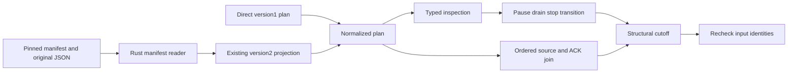
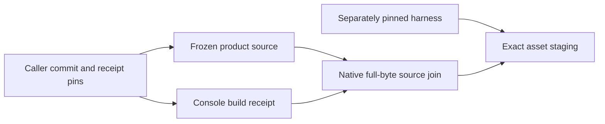
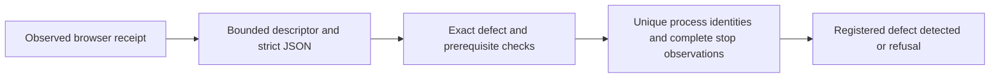

# Engineering evidence composition

The Rust `xtask evidence-preflight` command checks a caller-pinned inventory;
it neither executes jobs nor replaces acceptance graders. The
[contract](../experiments/formal/engineering-evidence-protocol.md) defines its
schema, bounded inputs, controls and finite experiment.

`File` ownership keeps no-follow directory descriptors alive across component
lookup. Streaming hashes and bounded JSON avoid retaining packages; one digest
per invocation serves repeated references. Device/inode/size/mtime/ctime checks
reject exercised replacement/write races, without authenticating hostile producers
or privileged concurrent writers.

Numeric adjacency/indegrees and a ready min-heap avoid rescanning dependencies.
Literal argv/source/exit/unit/stop joins refuse copied service identities and
unmet prerequisites. Bounds apply to the complete composition, not just output.
An incomplete inventory cannot reveal omitted required cases. The tooling-layer
crate uses existing locked dependencies; no product/core boundary changes.

The [architecture review skill](../../.agents/skills/architecture-review/SKILL.md)
routes unresolved design decisions to focused experiments and documentation work.
Existing Python product oracles stay independent; no MCP server is required.

## Structural lifecycle cutoff

`xtask custody-cutoff` composes bounded inspection text, a typed pause/drain/stop
transition and an ordered exact-byte ACK join. It reads pinned inspection bytes
through the existing artifact store; parsing never reopens an admitted path.
Raw and JSON bodies share its aggregate budget. Version1 accepts direct normalized
observations; version2 projects captured command/process/journal metadata in Rust
through the same owned reader and cutoff checker. The projection validates
ordered streams without sorting and keeps fixed lifecycle selection state;
only final trace/ACK/source output collections grow with input. It does not
retain parallel interval or index vectors. The decoder borrows its node
identity and uses fixed field slots. The ACK join requires ordered inputs and
uses constant auxiliary state, checking sender/window context in a lazy pass.
Capture-manifest mode reads digest-pinned original JSON members through Rust's
owned artifact reader, constructs the existing version2 input and reuses that
projection and cutoff path. Each JSON member is capped at 4 MiB, inspection text
at 4,096 bytes and aggregate retained input at 64 MiB. The direct version1 plan
interface remains supported.

Command intervals remain intervals. Journal emission times are separate inputs;
local stdout supplies none. The result cannot attest a producer, capture
completeness or process stop. Raw native binding and the independent Python
custody oracle remain mandatory. Guest capture records real command bounds,
pinned inspection text and process observations without deciding cutoff policy.
The native adapter applies its executable/service/InvocationID/cgroup/UID/GID
join to recognized Batch, configuration and delivery journal records; filtering
by PID alone does not establish that binding. The event output schema is unchanged.
The independent conservation oracle has an explicit native transition mode:
four stopped profiles are fixed at revision1/active, revision1/active,
revision2/paused and revision4/paused. It reparses retained configuration bytes
and joins their digest, size and original private file metadata; a cached parsed
view cannot override those bytes. The default static-profile rule is unchanged.
The guest effect adapter now requests the registered pause before observing a
stable acknowledged prefix, records a stopped inspection, and requests resume
while collection remains stopped. Reboot repeats the distinct revision sequence.
These operational waits do not replace the Rust cutoff or independent raw joins;
the host Python transport and independent Python archive/custody oracle remain
until an independently validated migration exists. Rust capture-reader controls
are finite engineering evidence only. Native execution requires a clean harness
revision present in `origin/main` and the existing pinned owner/helper admission;
no matching native capture or acceptance exists.
The [adapter contract](../experiments/formal/native-cutoff-adapter-protocol.md)
and [primitive protocol](../experiments/formal/primitive-composition-protocol.md)
separate finite controls from native caller adoption and alpha acceptance.
The [finite composition results](https://github.com/kmosoti/FabricO11y/wiki/Experiment-formal-primitive-composition-results-01) retain the measured variants and counterexamples.

The host transport drains stdout and stderr concurrently in bounded chunks,
retaining at most 65,536 bytes per stream and refusing overflow. This bound
belongs to the protocol streams: a global file-size limit would also truncate
LLVM profiles and other legitimate helper files. Pins, private output files,
strict JSON admission and the independent archive/custody joins still apply.
Each invocation has a maximum 60-second deadline within the caller's remaining
budget. Timeout or overflow stops the helper group, with at most two seconds
of subsequent pipe draining. Normal completion observes the leader with
`waitid(WNOWAIT)`, stops its group while the leader's PID remains reserved, then
reaps it and records its actual exit. Kernel-level wait completion still depends
on the mandatory outer resource group; this is not a sandbox for an untrusted
executable that deliberately escapes its process group.
## Pinned CI tool install

`cargo xtask install-tool <crate> <version>` is the effectful Rust boundary for
one explicitly pinned Cargo installation. It inherits `CARGO_HOME`, requires
2 GiB available DATA headroom, and assigns Cargo a private target under owned
scratch. A fixed 1500-second timeout kills the process group and reaps Cargo;
cleanup removes the target while retaining the log and JSON receipt under
`$FABRIC_STORAGE_ROOT/results/ci-tool-install/`. The Python resource-group
launcher remains mandatory outside this command. Registered controls and full fast migration verification ran at the revisions
recorded in the [execution record](https://github.com/kmosoti/FabricO11y/wiki/Experiment-formal-rust-ci-tooling-migration-results-01). No actual install is claimed by those local controls; see
the [installer protocol](../experiments/formal/rust-tool-installer-protocol.md).

## Native browser subgroup entry

The [registered supervisor correction](../experiments/formal/browser-supervisor-protocol.md)
adds a native `xtask browser-enter-exec` prefix to the legacy browser harness.
The caller pins and snapshots the helper explicitly. The helper enters its
canonical cgroup-v2 subgroup, checks its `/proc` placement, publishes `R` and
waits for `G`; each private pipe frame requires its byte followed by EOF within
the five-second monotonic deadline. A per-domain launch-attempt counter gives
each subgroup a unique name, including attempts that fail. The Python parent
retains the exact `Popen`/pidfd/start identity, checks placement and existing
membership, records the binding, and only then releases the target. Pre-binding
cleanup uses that retained child identity and its owned subgroup. The
session-clock wrapper stays the target when controlled time is selected.

The fixture-only session-clock helper serializes native clock observations with
a 100 ms unshifted CLOCK_MONOTONIC mutex deadline. Scheduling contention is not
a reason to terminate immediately after a fixed yield count. A timed-out or
failed acquisition still permanently refuses; it never supplies ordinary time
as expiry evidence. The [registered native contention controls](../experiments/formal/console-session-clock-protocol.md#native-lock-contention-counterexample)
exercise both a short held call and a genuine stall. This synchronization is
outside the product packages; real server binding and both fresh browser expiry
cells remain separate requirements.

The controlled-time browser witness observes the shipped connection card's
visible locked message/title, principal input and disabled sign-out, with no
protected results or owner identity. It joins that state to one completed
Check session401 in the actual browser request ledger. It does not depend on
an unshipped `locked-screen` attribute. The [semantic counterexample](../experiments/formal/console-session-clock-protocol.md#semantic-locked-view-counterexample)
retains the original false rejection and rejects partial/protected views and
missing or unrelated request evidence. The independent32-row session oracle
and all actual-server binding requirements are unchanged.

Ordinary descendant isolation rejects the fixture helper mapping, control key
and socket. The Firefox expiry observer additionally recognizes the exact
tested Firefox executable and mapped sandbox-library hashes when its own
`LD_PRELOAD=libmozsandbox.so` is present. Every other preload refuses; raw
observations are retained before the decision. The [registered counterexample](../experiments/formal/console-session-clock-protocol.md#firefox-sandbox-isolation-counterexample)
separates Firefox's native sandbox setup from escape of the clock fixture.

The expiry producer can place an already paced request50–700ms into a native
second. Forward jumps avoid an unnecessary whole-second stall; adjacent expiry
seconds still retain the offset and wait in real time. Every native clock call
is retained under the original1MiB ledger cap, and the unchanged oracle checks
all possible REALTIME calls against the request bracket and exact target
second. The [placement counterexample](../experiments/formal/console-session-clock-protocol.md#subsecond-dispatch-placement-counterexample)
records why a producer scheduling choice must not silently increase that cap.

The migration producer retains the legacy discovery result, then derives a
console-valid two-hour query window around its original canary timestamp for
the owner, reader and access CLI. The [window correction registration](../experiments/formal/browser-migration-protocol.md#console-window-fixture-correction)
keeps the independent exact-row, no-pagination and state-preservation grader
unchanged. A refused or missing original timestamp cannot create a new canary.

The registered Linux fixture and a finite real-browser engineering probe ran at
the pinned harness source `7508a989`. The browser ledger distinguishes received
HTTP responses from witnessed pre-response query cancellations; every received
response remains subject to the existing header checks. Native launches retained
pinned helper identity, exact reaping and empty owned groups. The previous
immediate-child entry failure remains preserved. These finite composition
results grant no exact-package browser acceptance credit; raw measurements and
failure history are in the
[canonical results record](https://github.com/kmosoti/FabricO11y/wiki/Experiment-formal-console-source-provenance-results-01).

## R3 supervisor caller pin

The current R3 admission carries the native entry helper as an explicit path
and SHA-256 input. `soak_r3.measure` passes that pair through
`ProductionAccess`, `CandidateFixture`, and `ConsoleBridge`; the existing
`BrowserSupervisor` command forwards it to `live_browser_check.browser_group_launch`,
which verifies the helper identity before launch and retains it in the child
binding. There is no PATH search or Python-helper fallback on this R3 path. The
frozen `5220e27` S1 snapshot used the older matching launch signature and is
not reinterpreted as having the current caller mismatch. The current source
controls and real supervisor-helper run remain pending; this wiring alone is
not browser or soak acceptance.

## Current-main release caller pin

The current-main `release_main`, `release_query`, and `release_stress` commands
now require an explicit browser-entry helper path and SHA-256 and pass both to
`CandidateFixture`. The production outage adapter exposes the same pair through
its existing options and validates the executable file and digest before
constructing the fixture. The shared candidate fixture repeats the pin check
and snapshots the same helper through its existing immutable-binary path. The
Rust-hosted source controls include execution of the actual call expressions,
CLI partial-pair refusals, and a bounded temporary-file `ProductionAccess`
composition seam; these controls were added after a targeted run observed the
old direct caller's missing-keyword `TypeError`. Verification remains pending.
No behavior in frozen #43/#46 runtimes changes, and these controls establish
harness input wiring only, not native launch or browser acceptance.

## Qualification adapter test gate

The Rust integration test `xtask/tests/qualification_adapters.rs` invokes the
eleven existing Python qualification unittest modules from `tools/qualification`
with a fixed `python3 -B -m unittest -v` argument list. It inherits the child's
output and propagates its exit status, so the workspace test gate cannot silently
skip the legacy controls. One existing sparse-file control exercises a logical
5 GiB boundary; the contained test job needs at least 6 GiB of DATA scratch for
the Python fixtures, plus the launcher's separate build allowance. This gate
checks finite adapter regressions only, not native or browser acceptance.

## Native BiDi viewport effect

The [viewport calibration](../experiments/formal/browser-supervisor-protocol.md#native-webdriver-bidi-viewport-calibration)
adds one bounded Rust `xtask browser-bidi-viewport` command to the existing
Firefox fixture. The Python caller requests WebDriver's returned BiDi URL and
passes that URL with the current classic window handle through the existing
hash-pinned browser-entry helper. The native command accepts only a loopback
URL, binds the supplied handle to one unique root context, and applies either
390 by 844 CSS pixels or `viewport: null`. Connect, handshake, command and reply
share a five-second deadline, with bounded messages and cumulative input.

The acknowledgement reports protocol completion, not geometry. Classic
WebDriver JavaScript independently reads 390 by 844 and unchanged DPR before
the existing zoom/font/negative-overflow predicates run. Normal completion and
the failure finalizer restore the BiDi viewport and classic desktop window;
failure capture remains before finalizer cleanup. This adapter addresses the
observed Firefox 157 `Set Window Rect` mismatch only. Firefox sessions also set
`unhandledPromptBehavior.confirm` to `ignore`, preserving the existing confirm
for its explicit WebDriver accept; the capability does not accept the prompt.
The independent Firefox comparison observed the same geometry with Bun and the Rust primitive, but
neither that probe nor the source controls grant browser acceptance. The [finite results](https://github.com/kmosoti/FabricO11y/wiki/Experiment-formal-console-source-provenance-results-01#native-bidi-viewport-and-confirmation-controls) retain actual geometry, confirmation and cleanup observations.

## Browser security request capture

The opt-in `--security-probes` browser check captures the completed registration
payload in private browser memory for the existing replay assertions. An
actual-source, no-network Bun diagnostic of frozen harness `73cccefc` found its
old observer threw before dispatch for `fetch(Request)` without init, while a
URL-plus-init control dispatched. The candidate wrapper's pinned-Bun effect
control passed Request-only capture, URL-plus-init, Request-plus-init body
override, and original Request-body readability at source SHA `667337d4`. A
blank Chrome probe found that constructing the inspection request from the
original `Request` consumed its body before forwarding. The clone-first
correction was exercised in a later blank Chrome run at source SHA
`3e588bbb5361722116a2f5fe07ca46d30efb0816bc0dd21be91a569201967af9`: six cases
and 16 predicates passed, including `bodyUsed == false` when the original
Request reached the fetch stub. The stub's subsequent body consumption is not
a wrapper invariant. Two intervening attempts were setup failures only: one
used stale operands and one had a truncated extracted script; neither gives a
behavior verdict. The final run returned DELETE 200, stopped both process
groups with empty kernels and reaped children, recorded the Bun client exit 0
and intentional ChromeDriver SIGTERM (-15), and removed scratch. The pinned-Bun
check and these browser effects are diagnostics, not product authentication or
browser acceptance. The Chrome06 terminal is
`/run/media/kmosoti/data/FabricO11y/results/chrome-fetch-browser-effect-01/terminal-06.json`
(SHA-256 `7a6341b31d3f26634000a2783ff01aea3b26748e1ee9440a5eb6e3fa14bc283c`).
The hosted workflow retains the ordinary positive Chrome command and artifact
at `ci-live-browser`, and runs a separate positive command with
`--security-probes` into `ci-live-browser-security`; the API-cache negative
command and grader remain separate and unchanged. The earlier hosted positive
result recorded 96 security checks, so it does not cover the restored ordinary
command. Earlier normal-mode coverage remains historical, and the result for
this three-command split is pending. See the
[security-probe criteria](../experiments/formal/console-access-protocol.md#prospective-signed-browser-security-supplement).

## Console source provenance

The [registered correction](../experiments/formal/console-provenance-protocol.md)
keeps frozen product source separate from executing harness source. A caller pins
the product checkout commit and build-receipt digest independently. The Rust
`xtask console-source` join reuses the bounded reader for that receipt and every source,
checks tracked paths and clean Git identity, then rechecks file identities.
The receipt's own source path grants no authority. Default development staging
still compares against its current checkout. Packaged mode takes five explicit
source/receipt/helper operands and executes the hash-pinned helper through the
existing immutable snapshots and owned browser process boundary, within 90 seconds
and the original fixture deadline. A capped log read serves the known helper's
bounded report; it does not bound arbitrary programs' disk output.

The legacy adapter caps explicit-mode receipts before parsing and admits at most
8 MiB of assets before reading payloads. An invocation-owned map retains verified
asset bodies; publication writes those bytes without reopening mutable inputs.
This trades bounded retained memory for one source-read pass and closes the
exercised verification/copy race. Final identity checks cover every recorded
snapshot role, including the verifier helper.

At `76d9f2b`, nine primitive, eight adapter and one readiness controls, existing
packaging/UI/cleanup suites and Clippy exited 0. The skipped-hash mutant, missing
helper inventory and copy-race RED results remain preserved. These finite controls
and the [warm source-hashing measurements](https://github.com/kmosoti/FabricO11y/wiki/Experiment-formal-console-source-provenance-results-01)
grant no package or browser acceptance. Full required checks and actual packaged
browser execution remain separate gates.

## Native verification receipts

`xtask verify-receipts` reuses the descriptor-owned artifact reader to join the
current registry, complete selected receipt inventory and each log digest. Its
[representation contract](../formal/verification-receipt-contract.md) deliberately
rejects duplicate JSON keys and numeric/boolean aliases. Git identity is checked
before and after validation; missing, failed or running checks cannot count as
a complete profile. CI now uses this command for final-profile validation.
The historical Python comparator remains reproducible from immutable
`f001175`; current Rust collector validation is a composition check, not an
independent oracle.

JSON is bounded per document and across the composition. Logs are streamed with
one complete digest per admitted artifact, then identities are rechecked. For N
checks and B admitted bytes, full-byte I/O requires Theta(B) work; metadata/JSON
indexing has additional collection-dependent costs. Reporting the stable duration
ordering adds O(N log N). The byte-reading lower bound is
Omega(B): sampled hashing cannot establish the same integrity contract. Metadata
rechecks are not an immutable filesystem snapshot or protection against a
privileged concurrent writer.

The optional `verification-sha-openssl` feature selects an existing locked crypto
provider behind a concrete incremental digest adapter. Otherwise RustCrypto is
used. The rejected assembly experiment remains archived with its protocol and
measured binaries; its optional feature and dependency were removed.
Known vectors and cross-provider chunk-boundary tests check equal bytes; this
changes no file admission, byte budget, product dependency or core policy. An
unsigned receipt still cannot prove that its declared command actually ran.

## Opt-in verification dispatch

`checks --profile fast --light-workers 2 --receipts NEW_DIR` keeps heavy checks
serial and dispatches only seven frozen lightweight command vectors through a
two-worker queue. Descending measured duration orders that queue; canonical ID
breaks ties. All other checks retain their registry order. Registry drift fails
closed, and the ordinary no-flag path stays serial. The
[dispatch policy](../formal/verification-dispatch-policy.md) defines the cohort
and required adoption controls.

One source/tool context and bounded revision snapshots serve the entire run.
Each check owns staging logs, receipts and scratch. The whole profile retains a
canonical running marker while workers finish, including after another failure.
Passed staged evidence is assembled and hashed before complete native validation;
exclusive publication checks those pinned bytes again. Artifact copying uses a
64 KiB buffer, an exact initial extent and a one-byte growth probe. Failure leaves
the marker and evidence; successful cleanup precedes marker removal. This bounds
copy scratch independently of log length, while retaining full-byte verification.
The Python receipt validator supplied the historical independent cross-check.
Current CI uses the Rust verifier and the separately authored contract fixture;
that shared implementation does not supply an independent cross-check.
Local integration receipts at `7fc4723` remain tied to that historical source.

## Hosted extended verification

Hosted extended verification runs the registered checks in two serial shards:
`semantic-mutants` and the other nine extended IDs. The required `extended` job
joins their disjoint receipts and invokes the Rust completeness validator
on the same source revision. This scheduling reduces elapsed time in
one completed hosted comparison while increasing aggregate runner time under
different CPU, cache and setup conditions; it does not alter check commands or
product acceptance criteria. See the [finite pilot record](../experiments/formal/verification-shards-protocol.md).

## Browser defect receipt grading

`xtask check-browser-defect` admits one descriptor-owned, bounded JSON receipt
and checks the exact API-cache or nonresident-enrollment failure plus its
prerequisites and structured cleanup evidence. A `BTreeSet` rejects duplicate
PID/start-tick pairs in O(log N) per group; all groups must be empty and reaped.
It preserves both fixture-removal and failure-evidence-retention dispositions.
The [adoption contract](../experiments/formal/browser-supervisor-protocol.md#rust-defect-receipt-grader-adoption)
records the stricter representation rules and the unchanged historical inputs.
This read-only grader does not launch a browser or establish native cleanup;
it checks the supplied observations. The existing hosted injected-defect step
remains the source of end-to-end evidence.

## Native storage census

`xtask storage-census` counts the complete explicit `FABRIC_STORAGE_ROOT` without
following directory symlinks. Owned directory descriptors anchor an iterative
depth-first traversal; each child is opened relative to its parent before its
metadata is counted. A checked accumulator commits all counters together. A
per-attempt accumulator prevents an interrupted walk from leaking partial totals
into a retry. Descriptor and iterator storage grows with active directory depth,
not the total number of files; complete accounting still requires visiting each
entry. Filesystem changes can prevent a consistent snapshot.

The [registered protocol](../experiments/formal/native-storage-census-protocol.md)
preserves hardlink-per-path and logical sparse-file accounting, ten attempts,
250 ms retry spacing and fatal permission/I/O errors. Only ENOENT in explicitly
recognized cleanup paths permits a full restart. An exact owned scratch argument
does not itself prove ownership; a caller must bind it to its admitted command.
Missing roots and RAM-backed roots fail closed. The six-field JSON result retains
the old accounting interface; product delivery/query/rate oracles are unchanged.

The `--owner-binding` mode takes an independently declared owner label and
admission path/digest plus the raw walkthrough argv. Its pure validator accepts
the exact program and five unique known flag/value pairs, joins the run ID,
label and outer-record path, and derives one scratch root. Unresolved digests,
crossed identities, duplicate flags and prefix siblings are refused. This binds
caller-supplied identities; it does not read or authorize admission content.
The original walkthrough guards retain that responsibility. The external frozen
driver adapter supplies these values and invokes the pinned executable in the
original user namespace without changing storage thresholds or resource caps.

The [finite comparison and counterexample record](https://github.com/kmosoti/FabricO11y/wiki/Experiment-formal-native-storage-census-results-01)
contains classification, real deletion controls, an actual partial-counter mutant
and a warm 20,000-path comparison. It also records a shared Cargo target returning
a mutant executable for a clean production worktree. Worktree/variant verification
therefore uses a distinct DATA target passed inside the resource launcher command;
source cleanliness alone is insufficient to identify a reused executable. Caller
adoption and fresh owner acceptance remain separate requirements.

## Split-host release guest

The [registered placement](../experiments/formal/release-placement-protocol.md)
keeps server/browser work on Blade and one KVM edge guest on G15. The existing
`cross_family.Guest` still provisions the OS, installs packages, runs producers
and reads clocks. `RemoteGuest` owns the SSH lifetime and loopback forwards;
`remote_worker.py` owns the same Guest on G15. An SSH stdin disconnect stops the
guest and retains a failure instead of manufacturing workload completion.

The resource launcher has explicit `edge`, `source` and `split-server` profiles.
It verifies actual payload cgroup memory/high/swap/CPU/task files before payload
execution; each profile retains a 1800-second service deadline. G15 uses an
explicit disk storage root and never inherits an assumed Olo job boundary.
A privileged host setup action must run in an explicitly bounded system service:
G15's sudo PAM session changes cgroups, so wrapping sudo in a user service does
not establish containment for its child. The live Spindle and Olo are outside
these fixture groups and retain their own services.

Staged manifests bind input hashes independently of SSH transfer success.
Native TLS and per-node credentials still authenticate Fabric delivery through
the forwards. A successful cell requires original command/exit/unit joins,
matching guest identities and stopped receipts on both hosts. Guest correlation
retains the full management round-trip bracket; clocks from different hosts
are not treated as one monotonic timeline. Finite adapter controls do not credit
an unrun cross-host workload or any release gate.

A failed or interrupted worker can still have confirmed process shutdown. The
remote adapter records those states separately: acceptance requires the original
nested command receipt, matching unit/argv/exits, guest identity and completion;
cleanup can additionally use an independent observation of the exact owned
cgroup being empty or removed. A missing original receipt never becomes a
successful workload through that cleanup proof. The
[retained bootstrap fixture](../experiments/formal/fixtures/remote-bootstrap-stop.json)
records the first actual nonzero worker exit with a confirmed stopped group.

Guest readiness still requires cloud-init exit zero and an empty swap table.
The disposable provisioner defers hostname setup to its final stage using
[cloud-init's documented preserve option](https://docs.cloud-init.io/en/latest/reference/yaml_examples/set_hostname.html).
It stops and masks only the Fedora guest's zram units before swapoff, using
[systemctl mask with --now](https://www.freedesktop.org/software/systemd/man/256/systemctl.html),
so a late queued swap activation cannot undo the intended fixture setup.
Degraded completion refuses immediately and retains its status output. These
steps change no execution-host swap, firewall or live service configuration.

The cross-family resource sampler keeps its original 330-sample horizon. Its
transient unit uses `RemainAfterExit=yes` so a completed monitor stays observable
while post-drain queries finish. The collector checks the actual unit state at
arming and collection, accepting a healthy running monitor or a retained clean
exit, and refusing missing or failed state even when a stop returns zero. If
still running at collection, the sampler acknowledges a controlled SIGTERM,
closes its output and exits cleanly; the collector records that original
completion before stopping its retained unit. The
[literal manager-state fixture](../experiments/formal/fixtures/cross-monitor-states.json)
retains the independent failure controls. A script exception also preserves its
original exit or timeout and output in an exclusive mode-0600 artifact; only the
stdin hash is retained. Neither mechanism changes an oracle or sampling rule.

The timing adapter distinguishes the registered offered edge log from the
native Spindle's exact diagnostic path. Offered rows retain their independent
offset/body/creation joins; edge diagnostics form a separate population using
the actual native source-acceptance bracket. Unknown log paths still refuse.
The [population registration](../experiments/formal/cross-family-forwarding-protocol.md#prospective-timing-population-clarification-and-backlog-revision)
applies the same ACK/visibility limits and retains every accepted row in custody,
queries, backlog and resource accounting. No product codec or independent oracle
changes at this boundary.

Cross-family offers retain their original coordinates and counts. Two bounded
HTTP workers wait for native trace intake independently of the producer clock;
overflow and unfinished workers fail the producer. A fixed five-second guard
separates the measured phase from intentional interruption while preserving
195 seconds of actual offered work and the full sixty-second outage workload.
An independent bounded observer adds per-answer clock brackets without removing
the original per-name reads or fixed queries. Grading checks every query with
the independent oracle and joins each row to its earliest completed same-boot
visibility witness. Worker errors and incomplete shutdown remain failures. The
[repair registration](../experiments/formal/cross-family-forwarding-protocol.md#producer-and-observation-repair-after-the-retained-split-smoke)
preserves the numerical limits and requires fresh full execution.
Producer and outage transient units also retain their original completion
state. The collector preserves each probe and requires loaded active/exited
success before accepting completion, independently of a successful status
transport or the source/end ledgers. Missing and failed states remain refused.
The producer's queue is bounded by the fixed total offer population, within its
unchanged 128 MiB service cap. This preserves the full fault workload when
transport stalls. The observer reuses the collector's existing named query
shapes; the product's metrics API still requires a name. One observer request
runs alongside the original serial reader, respecting the legacy endpoint's
two existing query permits, inside a fresh conservative per-node clock envelope. All
answers retain that envelope, every error is preserved immediately, and owned
query workers finish before the observer can complete. The original serial
query work remains; no metric wildcard API or clock point estimate is added.
The fixture explicitly records its existing Walk history configuration; this
does not change product defaults or the independent query oracle. Bounded HTTP
error bodies preserve refusal details together with original status.
