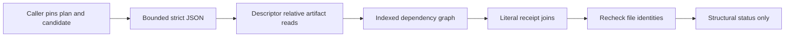

# Engineering evidence composition

This development tool checks a frozen plan against retained files. It does not
change the product runtime, execute jobs or replace registered acceptance graders.
The [prospective contract](../experiments/formal/engineering-evidence-protocol.md)
defines its schema, finite bounds, controls and measurements.

The file reader owns directory descriptors and refuses symlinks at each component.
It streams hashes and keeps only small JSON payloads; a per-invocation artifact
index avoids hashing the same input for each reference. Before/after identities
and a final check detect tested replacement/write races. They cannot authenticate
an untrusted producer or defeat a privileged writer with access to the process.

The graph uses ID indexes, adjacency lists and indegrees. A min-heap selects the
lexicographically first ready job without repeatedly rescanning all dependencies.
The cost is O((V+E) log V) time and O(V+E) state under explicit input limits.
Receipt composition compares literal commands, source revisions, expected exits,
unit identities and whole-service stop records. Reusing a stopped service for
two jobs is invalid. Pending dependencies remain visible rather than becoming
implicit passes.

These are Python tool primitives. The analogous Rust ownership idea is holding
a `File` for the object being examined rather than trusting a reusable pathname;
the product's existing file ownership and independent semantic oracles are
unchanged. Predictable finite behavior and measured costs matter more than an
unmeasured optimization label. The inventory is caller-supplied: an omitted
required acceptance cell must still be caught by reconciliation with its original
protocol, not by this structural tool.

Use the focused [architecture review skill](../../.agents/skills/architecture-review/SKILL.md)
for unresolved design choices and the existing experiment/documentation skills for
their respective work. No MCP server is required for these local commands.
