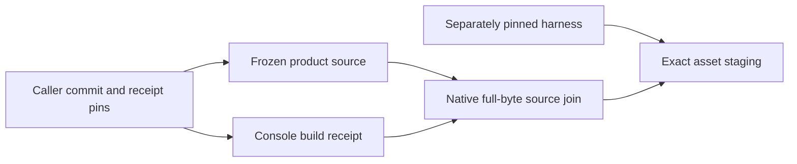

# Engineering evidence composition

The Rust `xtask evidence-preflight` command checks a caller-pinned inventory;
it neither executes jobs nor replaces acceptance graders. The
[contract](../experiments/formal/engineering-evidence-protocol.md) defines its
schema, bounded inputs, controls and finite experiment.

`File` ownership keeps no-follow directory descriptors alive across component
lookup. Streaming hashes and bounded JSON avoid retaining packages; one digest
per invocation serves repeated references. Device/inode/size/mtime/ctime checks
reject exercised replacement/write races, without authenticating hostile producers
or privileged concurrent writers.

Numeric adjacency/indegrees and a ready min-heap avoid rescanning dependencies.
Literal argv/source/exit/unit/stop joins refuse copied service identities and
unmet prerequisites. Bounds apply to the complete composition, not just output.
An incomplete inventory cannot reveal omitted required cases. The tooling-layer
crate uses existing locked dependencies; no product/core boundary changes.

The [architecture review skill](../../.agents/skills/architecture-review/SKILL.md)
routes unresolved design decisions to focused experiments and documentation work.
Existing Python product oracles stay independent; no MCP server is required.

## Native browser subgroup entry

The [registered supervisor correction](../experiments/formal/browser-supervisor-protocol.md)
adds a native `xtask browser-enter-exec` prefix to the legacy browser harness.
The caller pins and snapshots the helper explicitly. The helper enters its
canonical cgroup-v2 subgroup, checks its `/proc` placement, publishes `R` and
waits for `G`; each private pipe frame requires its byte followed by EOF within
the five-second monotonic deadline. The Python parent retains the exact
`Popen`/pidfd/start identity, checks placement and existing membership, records
the binding, and only then releases the target. Pre-binding cleanup uses that
retained child identity and its owned subgroup. The session-clock wrapper stays
the target when controlled time is selected.

The implementation has not yet received its registered Linux composition run.
The ignored integration fixture is separate from ordinary unit checks, and the
previous immediate-child entry failure remains preserved. These source changes
grant no browser acceptance credit.

## Console source provenance

The [registered correction](../experiments/formal/console-provenance-protocol.md)
keeps frozen product source separate from executing harness source. A caller pins
the product checkout commit and build-receipt digest independently. The Rust
`xtask console-source` join reuses the bounded reader for that receipt and every source,
checks tracked paths and clean Git identity, then rechecks file identities.
The receipt's own source path grants no authority. Default development staging
still compares against its current checkout. Packaged mode takes five explicit
source/receipt/helper operands and executes the hash-pinned helper through the
existing immutable snapshots and owned browser process boundary, within 90 seconds
and the original fixture deadline. A capped log read serves the known helper's
bounded report; it does not bound arbitrary programs' disk output.

The legacy adapter caps explicit-mode receipts before parsing and admits at most
8 MiB of assets before reading payloads. An invocation-owned map retains verified
asset bodies; publication writes those bytes without reopening mutable inputs.
This trades bounded retained memory for one source-read pass and closes the
exercised verification/copy race. Final identity checks cover every recorded
snapshot role, including the verifier helper.

At `76d9f2b`, nine primitive, eight adapter and one readiness controls, existing
packaging/UI/cleanup suites and Clippy exited 0. The skipped-hash mutant, missing
helper inventory and copy-race RED results remain preserved. These finite controls
and the [warm source-hashing measurements](https://github.com/kmosoti/FabricO11y/wiki/Experiment-formal-console-source-provenance-results-01)
grant no package or browser acceptance. Full required checks and actual packaged
browser execution remain separate gates.

## Native verification receipts

`xtask verify-receipts` reuses the descriptor-owned artifact reader to join the
current registry, complete selected receipt inventory and each log digest. Its
[representation contract](../formal/verification-receipt-contract.md) deliberately
rejects duplicate JSON keys and numeric/boolean aliases. Git identity is checked
before and after validation; missing, failed or running checks cannot count as
a complete profile. This command is implemented for experimental comparison;
required CI adoption is a separate step.

JSON is bounded per document and across the composition. Logs are streamed with
one complete digest per admitted artifact, then identities are rechecked. For N
checks and B admitted bytes, full-byte I/O requires Theta(B) work; metadata/JSON
indexing has additional collection-dependent costs. Reporting the stable duration
ordering adds O(N log N). The byte-reading lower bound is
Omega(B): sampled hashing cannot establish the same integrity contract. Metadata
rechecks are not an immutable filesystem snapshot or protection against a
privileged concurrent writer.

The optional `verification-sha-openssl` feature selects an existing locked crypto
provider behind a concrete incremental digest adapter. Otherwise RustCrypto is
used. The rejected assembly experiment remains archived with its protocol and
measured binaries; its optional feature and dependency were removed.
Known vectors and cross-provider chunk-boundary tests check equal bytes; this
changes no file admission, byte budget, product dependency or core policy. An
unsigned receipt still cannot prove that its declared command actually ran.

## Opt-in verification dispatch

`checks --profile fast --light-workers 2 --receipts NEW_DIR` keeps heavy checks
serial and dispatches only seven frozen lightweight command vectors through a
two-worker queue. Descending measured duration orders that queue; canonical ID
breaks ties. All other checks retain their registry order. Registry drift fails
closed, and the ordinary no-flag path stays serial. The
[dispatch policy](../formal/verification-dispatch-policy.md) defines the cohort
and required adoption controls.

One source/tool context and bounded revision snapshots serve the entire run.
Each check owns staging logs, receipts and scratch. The whole profile retains a
canonical running marker while workers finish, including after another failure.
Passed staged evidence is assembled and hashed before complete native validation;
exclusive publication checks those pinned bytes again. Artifact copying uses a
64 KiB buffer, an exact initial extent and a one-byte growth probe. Failure leaves
the marker and evidence; successful cleanup precedes marker removal. This bounds
copy scratch independently of log length, while retaining full-byte verification.
The unchanged Python receipt validator remains an independent cross-check before
adoption. Local integration receipts bind source `7fc4723`; current-head hosted
checks still gate workflow adoption.

## Hosted extended verification

Hosted extended verification runs the registered checks in two serial shards:
`semantic-mutants` and the other nine extended IDs. The required `extended` job
joins their disjoint receipts and invokes the independent Python completeness
validator on the same source revision. This scheduling reduces elapsed time in
one completed hosted comparison while increasing aggregate runner time under
different CPU, cache and setup conditions; it does not alter check commands or
product acceptance criteria. See the [finite pilot record](../experiments/formal/verification-shards-protocol.md).

## Native storage census

`xtask storage-census` counts the complete explicit `FABRIC_STORAGE_ROOT` without
following directory symlinks. Owned directory descriptors anchor an iterative
depth-first traversal; each child is opened relative to its parent before its
metadata is counted. A checked accumulator commits all counters together. A
per-attempt accumulator prevents an interrupted walk from leaking partial totals
into a retry. Descriptor and iterator storage grows with active directory depth,
not the total number of files; complete accounting still requires visiting each
entry. Filesystem changes can prevent a consistent snapshot.

The [registered protocol](../experiments/formal/native-storage-census-protocol.md)
preserves hardlink-per-path and logical sparse-file accounting, ten attempts,
250 ms retry spacing and fatal permission/I/O errors. Only ENOENT in explicitly
recognized cleanup paths permits a full restart. An exact owned scratch argument
does not itself prove ownership; a caller must bind it to its admitted command.
Missing roots and RAM-backed roots fail closed. The six-field JSON result retains
the old accounting interface; product delivery/query/rate oracles are unchanged.

The `--owner-binding` mode takes an independently declared owner label and
admission path/digest plus the raw walkthrough argv. Its pure validator accepts
the exact program and five unique known flag/value pairs, joins the run ID,
label and outer-record path, and derives one scratch root. Unresolved digests,
crossed identities, duplicate flags and prefix siblings are refused. This binds
caller-supplied identities; it does not read or authorize admission content.
The original walkthrough guards retain that responsibility. The external frozen
driver adapter supplies these values and invokes the pinned executable in the
original user namespace without changing storage thresholds or resource caps.

The [finite comparison and counterexample record](https://github.com/kmosoti/FabricO11y/wiki/Experiment-formal-native-storage-census-results-01)
contains classification, real deletion controls, an actual partial-counter mutant
and a warm 20,000-path comparison. It also records a shared Cargo target returning
a mutant executable for a clean production worktree. Worktree/variant verification
therefore uses a distinct DATA target passed inside the resource launcher command;
source cleanliness alone is insufficient to identify a reused executable. Caller
adoption and fresh owner acceptance remain separate requirements.
